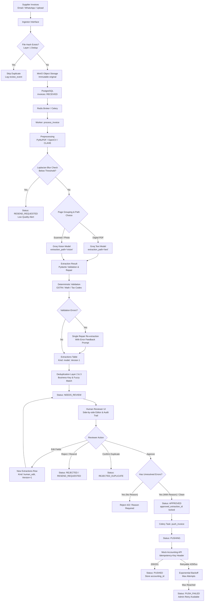

# InvoiceFlow: System Architecture

InvoiceFlow is an automated, human-in-the-loop invoice processing platform engineered for high accuracy, deterministic compliance checking, and seamless accounting integration.

---

## 1. End-to-End Processing Flow



---

## 2. Hard Requirements Coverage (R1–R4)

### R1: Multipage, Blurry, and Degraded Photos
- **Dual-Path Routing:** Invoices with digital text layers (>= 80 characters/page) are routed via PyMuPDF directly to `GROQ_TEXT_MODEL`, drastically reducing token costs and latency while preserving full character accuracy. Scanned documents or images route to `GROQ_VISION_MODEL`.
- **Image Enhancement:** Image inputs undergo EXIF auto-orientation, RGB conversion, deskewing via OpenCV (minimum-area rectangle on text pixels, angle correction between 0.5° and 15°), contrast normalization (CLAHE), and denoising.
- **Blur Detection:** Variance of the Laplacian is evaluated per page. If all pages fall below `BLUR_REJECT_THRESHOLD` (50.0), the invoice is safely routed to `RESEND_REQUESTED` without wasting LLM tokens or risking hallucination. If some pages are soft, a `low_image_quality` warning is affixed for reviewer attention.
- **Page Grouping & Batching:** Multipage invoices detect "Page X of Y" patterns and sequential line items. When documents exceed `GROQ_MAX_IMAGES_PER_REQUEST` (default 5), requests are batched and systematically merged (header fields from initial batch, line items appended in strict page order, totals taken from final page).

### R2: Zero Unreviewed Financial Data Reaches Accounting
- **Universal Human Gate:** Every invoice, regardless of extraction confidence, passes through `NEEDS_REVIEW`. There is strictly no auto-approval path in the codebase.
- **Database CHECK Constraint:**
  ```sql
  CHECK (status NOT IN ('PUSHING', 'PUSHED') OR (approved_by IS NOT NULL AND approved_extraction_id IS NOT NULL))
  ```
- **Approved Extraction Immutability:** When pushed, the worker exclusively loads `approved_extraction_id` rather than `current_extraction_id`. If an invoice is edited while in `APPROVED` status, the system automatically reverts its status to `NEEDS_REVIEW`.
- **Mandatory Override Reason:** Approving an invoice with active `error`-level validation issues requires a detailed human override explanation (minimum 10 characters), permanently logged in `review_events`.

### R3: Triple-Layer Duplicate Defense
- **Layer 1 (Byte-Level Deduplication):** Incoming files are hashed via SHA-256 before disk writes. Existing hashes return the existing invoice reference and record a `duplicate_file_skipped` audit event.
- **Layer 2 (Business Key Partial Unique Index):**
  - Business key consists of `(supplier_gstin, normalized_invoice_number, financial_year)`.
  - Normalization removes punctuation, spaces, and leading zeros from digit runs (`INV-0042` -> `INV42`).
  - Financial year is computed under Indian tax calendar (e.g. `2025-26`).
  - A PostgreSQL partial unique index enforces uniqueness for all active records (`WHERE dup_of_id IS NULL AND status NOT IN ('REJECTED', 'REJECTED_DUPLICATE')`).
  - Concurrent extraction races are caught via `IntegrityError` and gracefully marked as duplicates.
- **Layer 3 (Fuzzy Deduplication):** Matches with identical supplier, date, and total, but differing invoice numbers, trigger a `possible_duplicate` warning flag for reviewer investigation.
- **Controlled Override:** Legitimate duplicates (e.g., revised bills or credit notes) can be overridden by a reviewer with a mandatory audit-logged justification, which salt-hashes the idempotency key with the invoice ID during push.

### R4: Month-End Volume Spikes (4x Scale)
- **Celery Backpressure Management:** Workers run with `acks_late=True` and `worker_prefetch_multiplier=1` to guarantee fair task scheduling and prevent worker overload during 2,000+ invoice bursts.
- **Concurrency Limiting:** Global `asyncio.Semaphore` (`GROQ_MAX_CONCURRENCY`) throttles active LLM requests, respecting Groq API rate limits.
- **Atomic Compare-and-Set State Transitions:** State transitions are performed using `UPDATE invoices SET status = :new WHERE id = :id AND status = :expected`, ensuring duplicate task deliveries cannot double-process.

---

## 3. Technology Matrix

| Layer | Component | Choice & Rationale |
|---|---|---|
| **Backend API** | FastAPI / Python 3.12 | Async I/O, native Pydantic v2 validation, OpenAPI schema generation |
| **Database** | PostgreSQL 16 | Single source of truth, JSONB flexibility, CHECK constraints & triggers |
| **ORM & Migrations** | SQLAlchemy 2.0 (asyncpg) + Alembic | Modern async ORM, strict typed schemas, reproducible migrations |
| **Task Queue** | Celery + Redis | Robust distributed task execution, retry semantics, idempotency |
| **Object Storage** | MinIO (S3 API) | S3-compatible immutable document storage |
| **Computer Vision** | PyMuPDF + OpenCV + Pillow | High-speed text extraction, deskewing, blur detection |
| **LLM Provider** | Groq SDK (`AsyncGroq`) | Ultra-fast inference latency behind clean `Extractor` protocol |
| **Frontend UI** | React 18 + Vite + TS + Tailwind | Component-driven review UI with zoom-pan-pinch document viewer |
