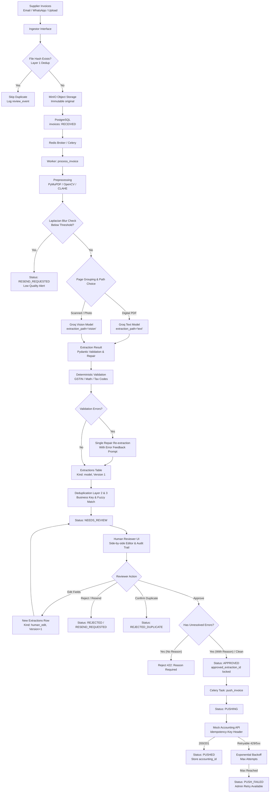
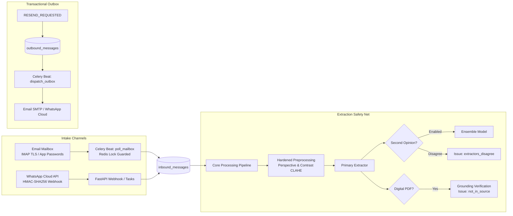
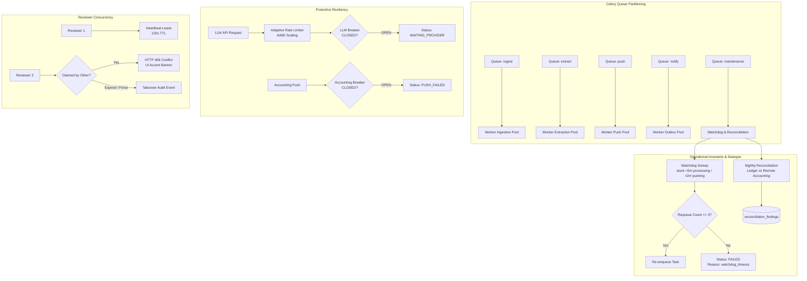
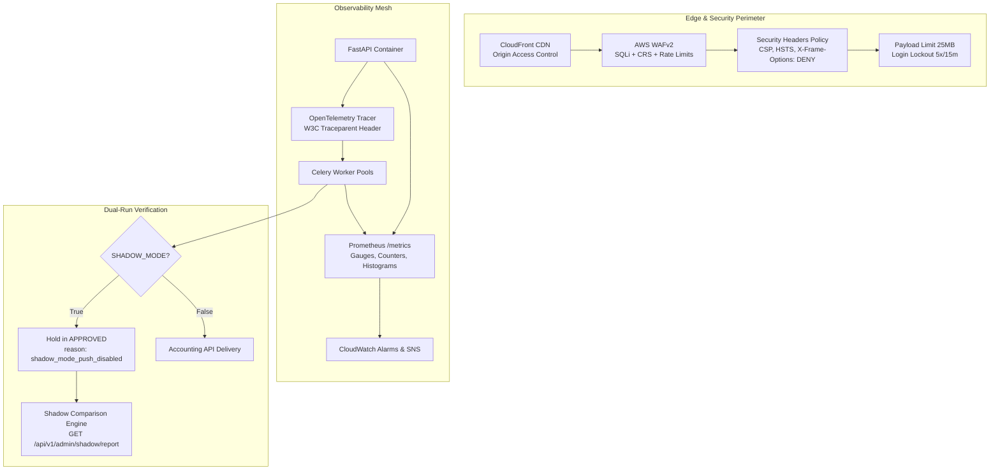

# InvoiceFlow: System Architecture

InvoiceFlow is an automated, human-in-the-loop invoice processing platform engineered for high accuracy, deterministic compliance checking, and seamless accounting integration.

---

## 1. End-to-End Processing Flow



---

## 2. Hard Requirements Coverage (R1–R4)

### R1: Multipage, Blurry, and Degraded Photos
- **Dual-Path Routing:** Invoices with digital text layers (>= 80 characters/page) are routed via PyMuPDF directly to `GROQ_TEXT_MODEL`, drastically reducing token costs and latency while preserving full character accuracy. Scanned documents or images route to `GROQ_VISION_MODEL`.
- **Image Enhancement:** Image inputs undergo EXIF auto-orientation, RGB conversion, deskewing via OpenCV (minimum-area rectangle on text pixels, angle correction between 0.5° and 15°), contrast normalization (CLAHE), and denoising.
- **Blur Detection:** Variance of the Laplacian is evaluated per page. If all pages fall below `BLUR_REJECT_THRESHOLD` (50.0), the invoice is safely routed to `RESEND_REQUESTED` without wasting LLM tokens or risking hallucination. If some pages are soft, a `low_image_quality` warning is affixed for reviewer attention.
- **Page Grouping & Batching:** Multipage invoices detect "Page X of Y" patterns and sequential line items. When documents exceed `GROQ_MAX_IMAGES_PER_REQUEST` (default 5), requests are batched and systematically merged (header fields from initial batch, line items appended in strict page order, totals taken from final page).

### R2: Zero Unreviewed Financial Data Reaches Accounting
- **Universal Human Gate:** Every invoice, regardless of extraction confidence, passes through `NEEDS_REVIEW`. There is strictly no auto-approval path in the codebase.
- **Database CHECK Constraint:**
  ```sql
  CHECK (status NOT IN ('PUSHING', 'PUSHED') OR (approved_by IS NOT NULL AND approved_extraction_id IS NOT NULL))
  ```
- **Approved Extraction Immutability:** When pushed, the worker exclusively loads `approved_extraction_id` rather than `current_extraction_id`. If an invoice is edited while in `APPROVED` status, the system automatically reverts its status to `NEEDS_REVIEW`.
- **Mandatory Override Reason:** Approving an invoice with active `error`-level validation issues requires a detailed human override explanation (minimum 10 characters), permanently logged in `review_events`.

### R3: Triple-Layer Duplicate Defense
- **Layer 1 (Byte-Level Deduplication):** Incoming files are hashed via SHA-256 before disk writes. Existing hashes return the existing invoice reference and record a `duplicate_file_skipped` audit event.
- **Layer 2 (Business Key Partial Unique Index):**
  - Business key consists of `(supplier_gstin, normalized_invoice_number, financial_year)`.
  - Normalization removes punctuation, spaces, and leading zeros from digit runs (`INV-0042` -> `INV42`).
  - Financial year is computed under Indian tax calendar (e.g. `2025-26`).
  - A PostgreSQL partial unique index enforces uniqueness for all active records (`WHERE dup_of_id IS NULL AND status NOT IN ('REJECTED', 'REJECTED_DUPLICATE')`).
  - Concurrent extraction races are caught via `IntegrityError` and gracefully marked as duplicates.
- **Layer 3 (Fuzzy Deduplication):** Matches with identical supplier, date, and total, but differing invoice numbers, trigger a `possible_duplicate` warning flag for reviewer investigation.
- **Controlled Override:** Legitimate duplicates (e.g., revised bills or credit notes) can be overridden by a reviewer with a mandatory audit-logged justification, which salt-hashes the idempotency key with the invoice ID during push.

### R4: Month-End Volume Spikes (4x Scale)
- **Celery Backpressure Management:** Workers run with `acks_late=True` and `worker_prefetch_multiplier=1` to guarantee fair task scheduling and prevent worker overload during 2,000+ invoice bursts.
- **Concurrency Limiting:** Global `asyncio.Semaphore` (`GROQ_MAX_CONCURRENCY`) throttles active LLM requests, respecting Groq API rate limits.
- **Atomic Compare-and-Set State Transitions:** State transitions are performed using `UPDATE invoices SET status = :new WHERE id = :id AND status = :expected`, ensuring duplicate task deliveries cannot double-process.

---

## 3. Technology Matrix

| Layer | Component | Choice & Rationale |
|---|---|---|
| **Backend API** | FastAPI / Python 3.12 | Async I/O, native Pydantic v2 validation, OpenAPI schema generation |
| **Database** | PostgreSQL 16 | Single source of truth, JSONB flexibility, CHECK constraints & triggers |
| **ORM & Migrations** | SQLAlchemy 2.0 (asyncpg) + Alembic | Modern async ORM, strict typed schemas, reproducible migrations |
| **Task Queue** | Celery + Redis | Robust distributed task execution, retry semantics, idempotency |
| **Object Storage** | MinIO (S3 API) | S3-compatible immutable document storage |
| **Computer Vision** | PyMuPDF + OpenCV + Pillow | High-speed text extraction, deskewing, blur detection |
| **LLM Provider** | Groq SDK (`AsyncGroq`) | Ultra-fast inference latency behind clean `Extractor` protocol |
| **Frontend UI** | React 18 + Vite + TS + Tailwind | Component-driven review UI with zoom-pan-pinch document viewer |

---

## 4. Key Architectural Trade-Offs

### 4.1 100% Human Review vs. Statistical Sampling
- **Decision:** Mandate 100% human review via `NEEDS_REVIEW` with strict database check constraints preventing any automated bypass.
- **Trade-off Analysis:** 
  - *Automated Straight-Through Processing (STP) with Sampling:* Maximizes throughput and reduces human operator costs on clean, high-confidence invoices.
  - *Universal Gate (InvoiceFlow approach):* In distributor wholesale operations, an undetected 10x quantity error or erroneous tax debit creates statutory GST penalties, buyer-supplier reconciliation disputes, and cash flow distortion. The operational overhead of 4 reviewers processing ~500 invoices/day (~2 minutes per invoice across a team) is vastly cheaper than recovering accounting discrepancies. R2 strictly prioritizes zero accounting contamination over marginal labor reduction.

### 4.2 Groq Open LPUs vs. Proprietary Frontier Models (e.g. GPT-4o / Claude 3.5 Sonnet)
- **Decision:** Call Groq directly via official Python SDK behind an abstract `Extractor` protocol.
- **Trade-off Analysis:**
  - *Frontier Cloud Models:* Offer marginally higher zero-shot parsing on obscure handwriting but incur 10x–30x higher inference cost and 3–8 second latency per call.
  - *Groq Inference Engine:* Sub-second token generation latency enables interactive preprocessing and immediate multi-attempt JSON repair cycles during worker ingest. Model pricing permits running 2,000 month-end invoices at negligible cost. Downstream deterministic validation and repair retry prompts compensate for any minor zero-shot reasoning gaps.

### 4.3 Text Path vs. Vision Path Routing
- **Decision:** Two-tier automatic routing based on digital text presence (>= 80 characters/page).
- **Trade-off Analysis:**
  - *Vision-Only Everywhere:* Simpler architecture, single model path. However, vision inference consumes substantial token quotas, limits request batching to image payload limits, and introduces OCR hallucination on small tabular fonts.
  - *Dual-Path Pipeline:* Digital PDFs (which represent ~70% of business invoices) bypass rasterization and vision processing entirely, transferring raw text to `GROQ_TEXT_MODEL` at 5x speed and 80% lower cost. The vision pipeline is reserved specifically for scanned documents, mobile photos, and degraded paper copies.

---

## 5. Data Model Summary

All primary entities use UUID primary keys, timezone-aware UTC timestamps, and optimistic locking (`row_version`):

- **`users`:** Accounts team and administrators with Argon2id password hashing and role-based permissions (`reviewer`, `admin`).
- **`suppliers`:** Master registry holding validated 15-character GSTINs, supplier legal names, and state codes.
- **`source_files`:** Immutable original files stored in MinIO with SHA-256 deduplication and source channel tracking (`upload`, `email`, `whatsapp`).
- **`invoices`:** Central state machine entity linked to the source file, status, optimistic locking version, approved/current extractions, and partial unique index on `(supplier_gstin, normalized_invoice_number, financial_year)`.
- **`extractions`:** Append-only versioned JSONB extractions (`model` or `human_edit`) preserving confidence scores, model IDs, token usage, and latency.
- **`validation_issues`:** Structured validation warnings and errors mapped per field and invoice.
- **`review_events`:** Tamper-proof, append-only audit trail protected by database triggers blocking `UPDATE` and `DELETE`.
- **`push_attempts`:** Log of accounting API delivery attempts with HTTP status codes and idempotency tracking.


---

## 4. Phase 4 Architecture: Real Intake & Safety Nets



### 4.1 Inbound Message Tracking & Channels
- `inbound_messages`: Central audit record keyed by unique `external_id` (`Message-ID` for email, `wamid` for WhatsApp). Idempotent handling ensures re-polling or webhook retries never duplicate work.
- **Email Poller:** Polls unseen messages, strips logo/signature graphics (<5 KB, image patterns), processes attachments, and moves messages to `Processed` (or `Failed`).
- **WhatsApp Webhook:** Validates `X-Hub-Signature-256` HMAC via constant-time comparison before processing. Aggregates photos sent within `WHATSAPP_GROUP_WINDOW_SECONDS` (90 s) into a single invoice, with reviewer `split-pages` action available in the UI.

### 4.2 Extraction Safety Nets
- **Grounding Verification:** For digital PDFs, extracted amounts, line items, and identifiers must appear verbatim in normalized source text. Unmatched amounts trigger blocking `not_in_source` errors.
- **Second Opinion:** Config-gated (`SECOND_OPINION_ENABLED`) ensemble model checks primary predictions. Total differences exceeding `TOTAL_ROUNDING_TOLERANCE` raise `extractors_disagree` warnings.

### 4.3 Transactional Outbox
- Moving an invoice to `RESEND_REQUESTED` queues an outbox row atomically.
- Dedicated worker task delivers notifications with daily sender rate limiting (`RESEND_MAX_PER_SENDER_PER_DAY = 3`).
- Notification bodies render rejection reasons without disclosing financial figures or amounts.

---

## 6. Phase 5 Architecture: Scale, Reliability & Operational Invariants



### 6.1 Review Concurrency & Heartbeat Leases
- Reviewers claim invoices upon opening the review workspace (`claimed_by`, `claim_expires_at`).
- Periodic heartbeats (every 45s) extend the lease window.
- Concurrent modifications by another user yield HTTP 409 Conflict.
- Leases can be explicitly released or superseded via audited takeover.

### 6.2 Backpressure & Circuit Breakers
- **Adaptive Limiter:** Adjusts concurrent request ceilings using AIMD algorithms based on HTTP 429 signals and sustained HTTP 200 successes.
- **Circuit Breakers:** Guard upstream LLM providers and downstream accounting APIs against cascade failure. When open, requests fast-fail without burning network sockets.

### 6.3 Watchdogs & Operational Invariants
- Watchdog sweep identifies orphaned or crashed tasks and re-enqueues them up to 3 times before dead-lettering.
- Invariants CLI validates the 4 core guarantees:
  1. No unreviewed financial data reaches accounting (`check_approved_before_push`).
  2. Idempotent deduplication layers are intact.
  3. No orphaned processing states exist without active queue tasks.
  4. Database audit logs remain strictly append-only.


---

## 7. Phase 6 Architecture: Security, Observability, IaC & Shadow Mode



### 7.1 Multi-Layer Defense-in-Depth
- **Prompt Injection Defense:** Document text encapsulated in `<untrusted_document_content>` tags with strict system prompt boundaries. Pydantic schema validation rejects non-schema structures. Universal Human Gate (R2) guarantees untrusted text never triggers automated approval.
- **Perimeter Hardening:** Strict Content Security Policy (CSP), HTTP Strict Transport Security (HSTS), X-Content-Type-Options: nosniff, X-Frame-Options: DENY, and 25 MB payload limits.
- **Account Security:** Argon2id password hashing, NIST-compliant password strength rules, 5-attempt login lockout with backoff, session revocation via `revoked_tokens` table, and RFC 6238 TOTP two-factor authentication for administrators.
- **File Safety & Privacy:** Presigned S3 URLs capped at `<= 300 seconds` (5 minutes) and scoped strictly to single objects. Path sanitation blocks directory traversal. Admin "Erase Invoice" action (`POST /api/v1/admin/invoices/{id}/erase`) redacts vendor PII, purges S3 files, and creates an immutable audit tombstone.

### 7.2 Full-Stack Observability
- **OpenTelemetry Tracing:** Distributed context propagation via W3C headers across API -> Redis Queue -> Worker -> Groq -> Accounting, tagging spans with `invoice_id`.
- **Prometheus Text Exposition (`/metrics`):** Real-time monitoring of queue depths and ages, invoice state distribution, circuit breaker states, LLM token consumption and costs, 429 rate, review claim counts, push outcomes, reviewer edit frequency, and watchdog requeues.
- **CloudWatch & Alerting:** Documented alert thresholds in `docs/ALERTS.md` covering queue starvation, circuit breaker trips, dead letters, and budget caps.

### 7.3 Infrastructure as Code (AWS ap-south-1)
- Modular Terraform in `infra/modules/` (`vpc`, `security`, `storage`, `database`, `cache`, `compute`, `frontend`, `observability`).
- Two isolated environments (`staging`, `prod`) using remote state in encrypted S3 with DynamoDB state locking.
- Multi-AZ PostgreSQL RDS with automated KMS encryption and backups.
- Private ElastiCache Redis replication with in-transit and at-rest encryption.
- Multi-stage non-root container images with automated rolling deployments and health check gates.

### 7.4 Shadow Mode (Safe Production Rollout)
- `SHADOW_MODE=true` allows the entire extraction, validation, and review pipeline to run without external accounting push side-effects.
- Accounts team manual entries imported via `POST /api/v1/admin/shadow/import`.
- Comprehensive comparison report `GET /api/v1/admin/shadow/report` computes field-level accuracy and vendor mismatch frequencies to satisfy go-live criteria.
