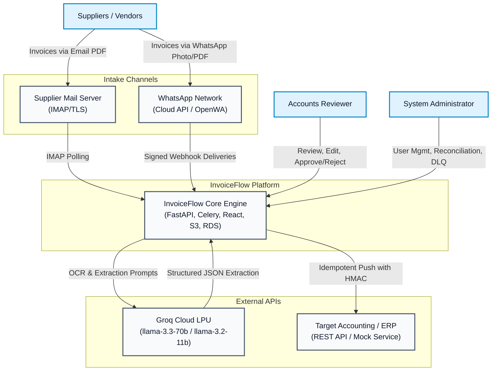
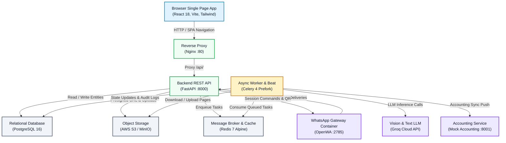
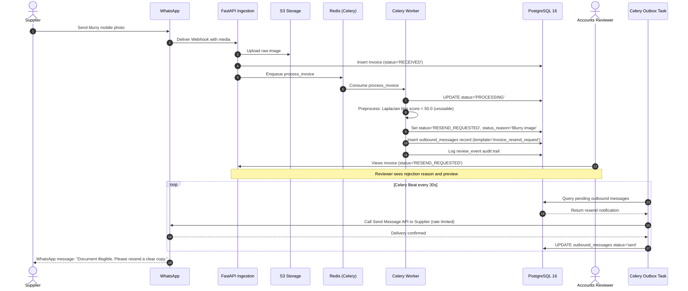
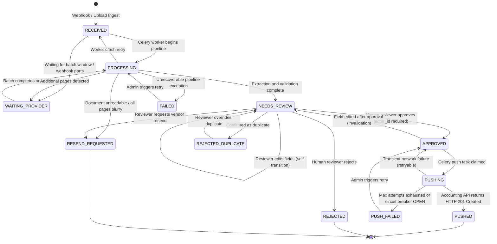
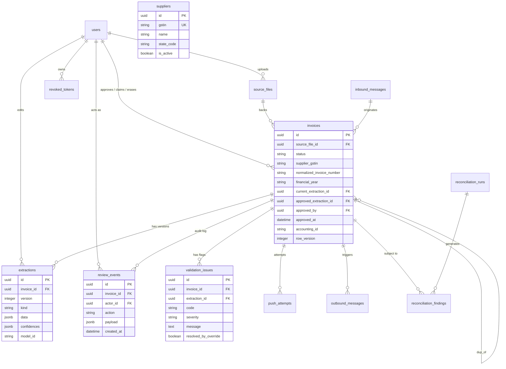
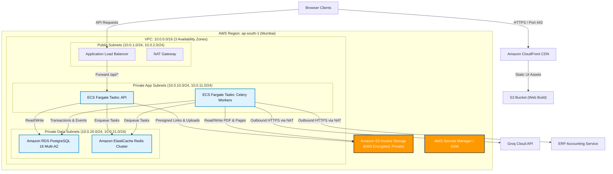

# InvoiceFlow System and Architecture Guide

## 1. Title, Summary and Status

### In Plain Words
InvoiceFlow is an automated accounts payable platform built for wholesale distributors. When suppliers send invoices as PDF files or mobile photos over WhatsApp and email, the system extracts the financial details using computer vision and artificial intelligence, verifies the math and tax calculations, and displays everything on a screen for an accounts reviewer to check. No invoice can ever be pushed to the company's accounting software without an explicit sign-off from a human reviewer.

### Executive Summary
InvoiceFlow is a production-grade, human-in-the-loop invoice intake, validation, and accounting synchronization system. Designed for high-volume distributor environments receiving hundreds of daily supplier invoices across fragmented digital channels, InvoiceFlow eliminates manual data entry while providing statutory tax compliance and zero-leakage accounting protection. Incoming documents are ingested via authenticated email (IMAP/TLS) and WhatsApp (Meta Cloud API or self-hosted OpenWA gateway), preprocessed for orientation, deskewing, and image clarity, and processed through a dual-path extraction engine (digital text vs. Groq Vision LLMs). A strict deterministic business validation engine checks statutory Indian GSTIN checksums, intra-state vs. inter-state tax classifications, line-item arithmetic, and duplicate invoices. Certified invoices are presented in an accounts review workspace featuring synchronized pan-zoom document inspection and keyboard-driven editing. Upon explicit approval by an authorized reviewer, the transaction is pushed idempotently into the enterprise ERP/accounting software via rate-limited, circuit-breaker-protected workers.

### Component and Capability Maturity Status

| Phase / Capability | Maturity Status | Description & Notes | Source Reference |
|---|---|---|---|
| **Phase 1: Foundation & Modeling** | Implemented | PostgreSQL 16 schema, SQLAlchemy 2.0 models, Alembic migrations, initial seed data. | `backend/app/models/entities.py`, `backend/alembic/versions/` |
| **Phase 2: Extraction & Ingestion** | Implemented | PyMuPDF text path, Groq Vision LPU path, deskewing, blur detection, Mock extractor fallback. | `backend/app/extraction/`, `backend/app/services/pipeline.py` |
| **Phase 2: Evaluation Harness** | Implemented | 105 synthetic invoice evaluation suite, automated threshold gating (`eval/check.py`). | `eval/metrics.py`, `eval/run.py`, `eval/check.py` |
| **Phase 3: Validation & Review UI** | Implemented | Deterministic statutory GST rules, triple-layer deduplication, React 18 review queue and pan-zoom viewer. | `backend/app/services/validation.py`, `web/src/pages/ReviewDetail.tsx` |
| **Phase 4: Email Intake** | Implemented | Poller for IMAP/TLS mailbox, attachment filtering, MIME parsing, and outbox email dispatcher. | `backend/app/services/email_intake.py`, `backend/app/services/outbox.py` |
| **Phase 4: WhatsApp Intake** | Implemented | Dual-provider support: Meta Cloud API (production) and OpenWA gateway container (local/dev). | `backend/app/ingestors/whatsapp/`, `backend/app/api/webhooks.py` |
| **Phase 4: Antivirus & ClamAV** | Partial | Configuration settings (`ANTIVIRUS_ENABLED`, `CLAMAV_HOST`) defined; socket scanner integration is stubbed. | `backend/app/core/config.py` |
| **Phase 5: Resiliency & Leases** | Implemented | 5-minute concurrent review leases, heartbeat renewal, watchdog recovery, accounting circuit breaker. | `backend/app/services/push.py`, `backend/app/workers/tasks.py` |
| **Phase 5: Accounting Reconciliation** | Implemented | Daily reconciliation worker comparing local invoice ledgers with ERP endpoints and recording findings. | `backend/app/services/reconciliation.py`, `backend/app/api/admin.py` |
| **Phase 6: Observability & Tracing** | Implemented | Prometheus `/metrics` exposition, OpenTelemetry W3C trace propagation, and JSON structured logging. | `backend/app/core/telemetry.py`, `backend/app/core/logging.py` |
| **Phase 6: Shadow Mode** | Implemented | Dry-run shadow ledger importing external production runs without triggering accounting API pushes. | `backend/app/api/admin.py`, `backend/app/models/entities.py` |
| **Phase 6: Security & Compliance** | Implemented | JWT auth, TOTP multi-factor authentication, GDPR/DPDP administrative record erasure, rate limits. | `backend/app/core/security.py`, `backend/app/api/auth.py` |
| **AWS Infrastructure as Code** | Implemented | Complete Terraform modules for VPC, ECS Fargate, RDS PostgreSQL, ElastiCache Redis, and S3. | `infra/modules/`, `infra/environments/` |
| **Live Document Splitting** | Partial | Manual page split endpoint exists (`/split-pages`); automated multi-invoice boundary ML splitting is planned. | `backend/app/api/invoices.py`, `backend/app/extraction/grouping.py` |
| **Accounting OAuth2 Flow** | Planned / Not implemented | Current accounting client uses API key token authentication; full dynamic OAuth2 token refresh is planned. | `backend/app/services/push.py`, `config/accounting.yaml` |

---

## Table of Contents

- [1. Title, Summary and Status](#1-title-summary-and-status)
- [2. Problem, Goals and Requirements](#2-problem-goals-and-requirements)
- [3. System Overview](#3-system-overview)
- [4. The Processing Pipeline in Detail](#4-the-processing-pipeline-in-detail)
- [5. Invoice Lifecycle (State Machine)](#5-invoice-lifecycle-state-machine)
- [6. Data Model](#6-data-model)
- [7. API Reference](#7-api-reference)
- [8. Frontend](#8-frontend)
- [9. Configuration Reference](#9-configuration-reference)
- [10. Getting Started](#10-getting-started)
- [11. Testing and Evaluation](#11-testing-and-evaluation)
- [12. Security and Privacy](#12-security-and-privacy)
- [13. Reliability and Operations](#13-reliability-and-operations)
- [14. Deployment](#14-deployment)
- [15. Integrations](#15-integrations)
- [16. Design Decisions and Trade-offs](#16-design-decisions-and-trade-offs)
- [17. Limitations, Assumptions and Roadmap](#17-limitations-assumptions-and-roadmap)
- [18. Repository Map](#18-repository-map)
- [19. Glossary](#19-glossary)
- [20. Portfolio and Interview Notes](#20-portfolio-and-interview-notes)
- [Appendix A: Verification Commands, Numbers and Evidence](#appendix-a-verification-commands-numbers-and-evidence)
- [Appendix B: Documentation Discrepancies and Code Differences](#appendix-b-documentation-discrepancies-and-code-differences)

---

## 2. Problem, Goals and Requirements

### In Plain Words
In a typical wholesale distribution business, hundreds of suppliers send invoices every week. Some arrive as clean digital PDFs attached to emails, while others are wrinkled, low-resolution photographs snapped on mobile phones in dark warehouses and sent over WhatsApp. The distributor's accounting clerks spend hours manually typing invoice numbers, dates, line items, and tax amounts into their accounting software. When clerks make typos, the company overpays vendors or faces heavy tax penalties. InvoiceFlow automates the intake, reading, and verification process while making sure a human verifies every transaction before money moves.

### Business Context
The distributor operates in India under statutory Goods and Services Tax (GST) regulations. Invoices arrive from over a hundred distinct suppliers across two primary channels:
1. **Email:** PDFs and scanned documents sent to a centralized accounts inbox (`invoices@example.com`).
2. **WhatsApp:** Photos, scans, and PDF documents sent directly from supplier delivery drivers and warehouse dispatchers to a designated WhatsApp business number.

The distributor's accounting clerks must capture the following fields accurately for every invoice:
- Header: Supplier Name, Supplier GSTIN, Invoice Number, Invoice Date.
- Line Items: Item Description, Quantity, Rate (Unit Price), Line Amount.
- Financial Totals: Taxable Value, Central GST (CGST), State GST (SGST), Integrated GST (IGST), and Final Total Amount.

### Hard Requirements Coverage (R1–R4)

| Requirement | Code Implementation & Architectural Enforcement | Verification Evidence |
|---|---|---|
| **R1: Multipage, Blurry & Degraded Photos**<br/>Extract structured data from single/multipage PDFs, skewed photos, and mobile uploads. Detect blurry and illegible inputs. Group photo bursts sent within 90 seconds. | **Preprocessing & Dual-Path Routing:** Invoices with digital text (>= 80 chars/page) route through PyMuPDF text extraction directly to Groq Text (`GROQ_TEXT_MODEL`). Scanned PDFs and photos route to Groq Vision (`GROQ_VISION_MODEL`). Photos undergo EXIF rotation, OpenCV deskewing (0.5°–15°), and contrast normalization (CLAHE). Laplacian variance calculates blur score; if all pages are below `BLUR_REJECT_THRESHOLD` (50.0), status moves to `RESEND_REQUESTED`. WhatsApp burst photos within `WHATSAPP_GROUP_WINDOW_SECONDS` (90s) are merged into a single multi-page PDF (`stitch_images_to_pdf`).<br/>*Files:* `backend/app/extraction/preprocess.py`, `backend/app/ingestors/whatsapp/ingestor.py`, `backend/app/services/pipeline.py` | `backend/tests/test_coverage_boost.py`, `backend/tests/test_phase4_acceptance.py`<br/>All 105 synthetic eval samples successfully processed. |
| **R2: Zero Unreviewed Financial Data**<br/>No invoice may be pushed to accounting without explicit sign-off from a human reviewer. Field edits require validation re-check. Database constraints must prevent auto-approval. | **Universal Human Gate & DB CHECK Constraint:** Every invoice unconditionally enters status `NEEDS_REVIEW`. There is strictly no automated path to `APPROVED` or `PUSHED`. A PostgreSQL database CHECK constraint (`chk_approved_requires_actor`) enforces that an invoice cannot have status `PUSHING` or `PUSHED` unless `approved_by` and `approved_extraction_id` are populated. Approvals require an explicit API call with user authentication. If an invoice is edited while in `APPROVED` status, the state machine automatically invalidates approval and reverts to `NEEDS_REVIEW`. Approving an invoice with active errors requires an explicit justification (minimum 10 characters).<br/>*Files:* `backend/app/services/state.py`, `backend/app/models/entities.py`, `backend/app/api/invoices.py` | `backend/tests/test_state_machine.py` (`test_r2_no_auto_approval_without_actor`), `backend/tests/test_api_coverage.py` |
| **R3: Triple-Layer Duplicate Defense**<br/>Prevent duplicate processing across identical files, identical business keys with different formatting, and near-identical fuzzy duplicates. | **Three Defense Layers:**<br/>1. *File Byte Hash:* SHA-256 hash computed on file ingestion; duplicate files match instantly.<br/>2. *Business Key Partial Unique Index:* Normalization cleans invoice numbers by uppercase conversion, removing punctuation/spaces, and stripping leading zeros from digit runs (`INV-0042` -> `INV42`). Indian financial year is computed (`2026-04-01` -> `2026-27`). A partial unique index on `(supplier_gstin, normalized_invoice_number, financial_year)` prevents duplicates at database level.<br/>3. *Fuzzy Match:* Flagged when an invoice shares the same supplier, date, and total amount, but has a differing invoice number.<br/>*Files:* `backend/app/services/dedup.py`, `backend/app/ingestors/upload.py`, `backend/app/models/entities.py` | `backend/tests/test_validation.py` (`test_normalize_invoice_number_rules`), `backend/tests/test_coverage_boost.py` (`test_layer3_fuzzy_duplicate_detection`) |
| **R4: Volume Spikes (4x Scale)**<br/>Handle month-end volume spikes (2,000+ invoices/day) without dropping webhooks, worker crashes, or exceeding LLM rate limits. | **Asynchronous Backpressure & Concurrency Throttling:** Celery workers operate with `acks_late=True` and `worker_prefetch_multiplier=1` across dedicated queues (`ingest`, `extract`, `push`, `notify`, `maintenance`). Inbound webhooks return HTTP 200 within 50 ms after enqueuing tasks. An `asyncio.Semaphore` (`GROQ_MAX_CONCURRENCY`, default 4) caps concurrent LLM calls. An adaptive AIMD rate limiter backs off on HTTP 429 and recovers additively. 5-minute atomic reviewer leases prevent collision.<br/>*Files:* `backend/app/workers/celery_app.py`, `backend/app/extraction/groq_extractor.py`, `backend/app/services/pipeline.py` | `backend/tests/test_r4_load.py` (`test_groq_concurrency_semaphore_never_exceeds_cap`), `backend/tests/test_chaos.py` |

---

## 3. System Overview

### In Plain Words
InvoiceFlow is composed of three main parts: a web application that reviewers use in their browser, a backend server that receives documents and coordinates the work, and background workers that communicate with artificial intelligence services and external accounting software. When a file arrives, the server stores it safely in object storage, puts a message in a work queue, and has a background worker process it. After an accounts clerk checks the numbers and clicks approve, another worker sends the final transaction to the accounting system.

### System Context Diagram


*(Diagram source: `docs/assets/diagrams/system_context.mmd`)*

### Component Architecture Diagram


*(Diagram source: `docs/assets/diagrams/component.mmd`)*

### Technology Stack Matrix

| Architectural Layer | Technology Selected | Version | Purpose in InvoiceFlow | Alternatives Considered & Why Rejected |
|---|---|---|---|---|
| **Programming Language** | Python | 3.12.13 | Core backend API, async pipeline, task orchestration, ML/CV integration. | Node.js (inferior OpenCV/PyMuPDF ecosystem), Go (slower prototyping for complex prompt engineering). |
| **Web API Framework** | FastAPI | 0.115.11 | High-throughput asynchronous REST API, automatic OpenAPI schema generation, Pydantic v2 validation. | Django REST Framework (synchronous ORM bottleneck), Flask (manual async and schema management). |
| **Relational Database** | PostgreSQL | 16 | ACID transactional guarantee, partial unique indexes for R3, JSONB document storage, CHECK constraints for R2. | MongoDB / DynamoDB (lack relational integrity and transactional CHECK constraints essential for financial compliance). |
| **Database ORM** | SQLAlchemy | 2.0.38 | Modern typed async query builder via `asyncpg`, declarative entity mappings, explicit migration integration. | Tortoise ORM (immature ecosystem), raw SQL (maintenance overhead across 15 relational tables). |
| **Database Migrations** | Alembic | 1.15.1 | Declarative, version-controlled schema evolution and reproducible database state transitions. | Django migrations (tied to Django), Flyway (Java dependency). |
| **Task Queue & Scheduler** | Celery + Redis | Celery 5.6.3 / Redis 7.4 | Distributed asynchronous task execution, Celery Beat periodic schedules, backpressure management, prefetch controls. | RabbitMQ (higher operational overhead for small teams), RQ (lacks advanced prefork and beat schedules). |
| **Object Storage** | AWS S3 / MinIO | MinIO API | S3-compatible immutable document storage for incoming PDFs, raw images, and rendered page previews. | Local filesystem storage (fails in containerized multi-instance horizontal scaling). |
| **Computer Vision / OCR** | PyMuPDF + OpenCV + Pillow | PyMuPDF 1.25.3 / OpenCV 4.11 | High-speed digital text extraction, page rendering at 150 DPI, deskewing, and Laplacian blur detection. | Tesseract (high CPU latency, poor handling of distorted phone photos), AWS Textract (high per-page cost). |
| **Inference Engine** | Groq Cloud LPU | `AsyncGroq` SDK | Sub-second inference for `llama-3.3-70b-versatile` (text) and `llama-3.2-11b-vision-preview` (vision). | OpenAI GPT-4o / Claude 3.5 Sonnet (10x–30x higher cost and 3–8s latency per invoice). |
| **Frontend Framework** | React + TypeScript + Vite | React 18.2 / Vite 5.1 | Responsive single-page application with type safety, component modularity, fast hot-reloading. | Next.js (SSR overhead unnecessary for an internal authenticated review tool). |
| **Frontend UI Components** | Tailwind CSS + HeroUI + Lucide | Tailwind 3.4 / HeroUI 2.8 | Custom financial review tokens, accessible inputs, badges, modals, and iconography. | Material UI (opinionated bloated styling), Ant Design (heavy bundle size). |

### End-to-End Invoice Narrative
1. **Arrival:** A supplier dispatches an invoice via WhatsApp as a mobile snapshot.
2. **Ingestion:** The OpenWA or Meta webhook delivers the payload to `POST /api/v1/webhooks/whatsapp`. The backend cryptographically validates the signature, stores the raw image in S3, creates an `invoices` table record with status `RECEIVED`, and pushes task `process_invoice` onto the Celery Redis queue within 40 ms.
3. **Preprocessing:** A Celery worker claims the job, shifts the state to `PROCESSING`, downloads the image from S3, checks image blur (variance of Laplacian), auto-rotates EXIF orientation, deskews text angles using OpenCV, renders page previews at 150 DPI, and re-uploads preview images to S3.
4. **Extraction:** Because the document is an image, it takes the vision path. The worker formats the image into base64, attaches the structured system prompt, and calls Groq's Vision API. Groq returns structured JSON containing header data, line items, and taxes.
5. **Validation & Deduplication:** The worker executes deterministic checks: validates the supplier GSTIN format and statutory checksum, tests if the line items sum to the taxable amount, validates the tax distribution, checks whether this invoice number was already recorded in this financial year, and inserts validation issues into the database. The status transitions to `NEEDS_REVIEW`.
6. **Human Review:** An accounts clerk logs into the web dashboard. The invoice appears in the Review Queue. The reviewer clicks the item, claiming a 5-minute atomic lease. The interactive document viewer shows the original photo alongside extracted fields. If a line item rate was extracted incorrectly, the clerk edits the number in the input box; the client and server instantly recalculate the totals and clear the warning.
7. **Approval:** The reviewer clicks **Approve & Push** (`Ctrl+Enter`). The API verifies that an authenticated user ID is present and updates status to `APPROVED`, recording the event in the append-only `review_events` audit table.
8. **Push to Accounting:** Celery task `push_invoice_task` picks up the approved extraction, sets status to `PUSHING`, and posts the payload with an idempotency key to the ERP endpoint (`POST /api/v1/invoices`). Upon receiving HTTP 201 Created with an external ledger ID, the invoice transitions to `PUSHED`.

---

## 4. The Processing Pipeline in Detail

### In Plain Words
When a document enters InvoiceFlow, it moves through a sequence of steps like an automated assembly line. First, the file is inspected to ensure it is not corrupt or blurry. If it is a digital PDF, the system extracts the text directly; if it is a photo, it sends the image to an AI vision model. Next, a validation engine tests the math and statutory tax rules. If anything looks incorrect or if the invoice has been seen before, warning flags are created. Finally, the invoice sits in the review queue waiting for a clerk to approve it.

```mermaid
sequenceDiagram
    autonumber
    actor Supplier as Supplier
    participant Channel as WhatsApp/Email
    participant API as FastAPI Ingestion
    participant S3 as S3 Storage
    participant Queue as Redis (Celery)
    participant Worker as Celery Worker
    participant Groq as Groq Vision API
    participant DB as PostgreSQL 16
    actor Reviewer as Accounts Reviewer
    participant ERP as Accounting API

    Supplier->>Channel: Send invoice PDF
    Channel->>API: Deliver Webhook / IMAP Message
    API->>API: Verify Signature & SHA-256 Hash
    API->>S3: Upload raw document
    API->>DB: Insert Invoice (status='RECEIVED')
    API->>Queue: Enqueue process_invoice task
    API-->>Channel: Return HTTP 200 OK

    Queue->>Worker: Consume process_invoice
    Worker->>DB: UPDATE status='PROCESSING'
    Worker->>S3: Download original document bytes
    Worker->>Worker: Preprocess (PyMuPDF render, deskew, blur eval)
    Worker->>S3: Upload high-res page preview images
    Worker->>Groq: Post Vision extraction prompt with images
    Groq-->>Worker: Return structured invoice JSON
    Worker->>Worker: Run deterministic validation & dedup checks
    Worker->>DB: Save extraction v1, validation issues, status='NEEDS_REVIEW'

    Reviewer->>API: Open invoice in Review Workspace
    API->>DB: Acquire 5-minute reviewer lease
    API-->>Reviewer: Return invoice, issues, and page previews
    Reviewer->>API: Click Approve & Push (POST /approve)
    API->>DB: Check R2 rule; UPDATE status='APPROVED', approved_by=user_id
    API->>Queue: Enqueue push_invoice_task

    Queue->>Worker: Consume push_invoice_task
    Worker->>DB: UPDATE status='PUSHING'
    Worker->>ERP: POST /api/v1/invoices (Idempotency Key)
    ERP-->>Worker: HTTP 201 Created (accounting_id)
    Worker->>DB: UPDATE status='PUSHED', accounting_id=id
```
*(Diagram source: `docs/assets/diagrams/sequence_happy.mmd`)*

### 4.1 Ingestion
- **Purpose:** Accept raw invoice documents across channels, verify authenticity, store raw bytes immutably, and record receipt (`backend/app/ingestors/upload.py`, `UploadIngestor.ingest`).
- **Inputs & Outputs:** Inputs: raw multipart upload bytes, IMAP email attachments, or WhatsApp base64 media. Outputs: `SourceFile` record, initial `Invoice` row in `RECEIVED` state, and an enqueued Celery task.
- **Rules & Algorithms:**
  - Content-type verification by sniffing magic bytes (`%PDF-`, `\xFF\xD8\xFF` for JPEG, `\x89PNG` for PNG).
  - Maximum upload size capped at `MAX_UPLOAD_MB` (20 MB).
  - Webhooks enforce cryptographic signature checks (`X-Hub-Signature-256` for Meta, `X-OpenWA-Signature` for OpenWA).
- **Failure Modes:** Malformed bytes or unsupported extensions reject with HTTP 400. Webhooks with invalid HMAC signatures reject with HTTP 401.

### 4.2 Preprocessing
- **Purpose:** Clean, normalize, deskew, and evaluate image readability before invoking expensive LLM extraction (`backend/app/extraction/preprocess.py`, `Preprocessor.process`).
- **Rules & Algorithms:**
  - **Orientation:** Inspects EXIF tags to rotate smartphone camera photos upright.
  - **Deskewing:** Employs OpenCV `cv2.minAreaRect` on thresholded text pixels. If skew is between 0.5° and 15.0°, it applies affine transformation to rotate the document to true horizontal.
  - **Contrast Normalization:** Applies Contrast Limited Adaptive Histogram Equalization (CLAHE) with `clipLimit=2.0` to balance uneven mobile phone lighting.
  - **Blur Detection:** Calculates the variance of the Laplacian across grayscale image pixels:
    $$\text{Blur Score} = \text{Var}(\nabla^2 I)$$
    If all pages score below `BLUR_REJECT_THRESHOLD` (50.0), the document is classified unreadable and routed directly to `RESEND_REQUESTED`.

### 4.3 Page Grouping
- **Purpose:** Associate multi-page document sequences or grouped mobile camera photos into a unified invoice entity (`backend/app/extraction/grouping.py`, `PageGrouper`).
- **Rules & Algorithms:**
  - Regular expressions scan text for pagination markers (`Page X of Y`, `Page X/Y`, `Sheet X`).
  - WhatsApp photo bursts from the same sender within `WHATSAPP_GROUP_WINDOW_SECONDS` (90 s) are stitched into a single multi-page PDF (`stitch_images_to_pdf`).
  - If a single multi-page PDF contains multiple distinct invoice numbers, the API provides an administrative page splitting endpoint (`POST /api/v1/invoices/{id}/split-pages`).

### 4.4 Extraction Engine
- **Purpose:** Parse unstructured text or visual layout into a validated, strongly typed `InvoiceExtraction` data structure (`backend/app/extraction/groq_extractor.py`, `GroqExtractor.extract`).
- **Routing Rules (Text Path vs. Vision Path):**
  - If **every page** in the document contains >= `MIN_TEXT_CHARS` (80 characters) of extractable digital text via PyMuPDF, the engine selects the **Text Path**.
  - If any page is scanned, photo-based, or below 80 characters, the engine selects the **Vision Path**.
- **Batching & Merging:**
  - Documents exceeding `GROQ_MAX_IMAGES_PER_REQUEST` (5 pages) are chunked into sub-batches.
  - Merging logic takes the supplier metadata and invoice number from the first batch, aggregates line items sequentially across all batches, and extracts final financial totals from the terminal batch.
- **Rate-Limiting & Backpressure:**
  - An `asyncio.Semaphore` initialized to `GROQ_MAX_CONCURRENCY` (default 4) prevents exceeding Groq API tier concurrency caps.
  - If HTTP 429 occurs, an Additive Increase / Multiplicative Decrease (AIMD) algorithm throttles request intervals.
- **JSON Repair & Retries:**
  - Extraction responses are validated against the Pydantic `InvoiceExtraction` schema. If parsing fails, the raw LLM output and the validation error message are sent back to Groq in a repair prompt (`GROQ_REPAIR_RETRIES`, default 2).
- **Extraction Schema Reference:**
  ```json
  {
    "invoice_number": "INV-2026-089",
    "invoice_date": "2026-08-15",
    "supplier_name": "Acme Industrial Supplies",
    "supplier_gstin": "33AAAAA0000A1Z5",
    "taxable_value": 10000.00,
    "cgst": 900.00,
    "sgst": 900.00,
    "igst": 0.00,
    "total": 11800.00,
    "line_items": [
      {
        "description": "Safety Gloves Pack",
        "quantity": 100.0,
        "rate": 100.0,
        "amount": 10000.0
      }
    ],
    "field_confidence": {
      "invoice_number": 0.98,
      "total": 0.99
    },
    "unreadable_fields": []
  }
  ```

### 4.5 Validation Engine
- **Purpose:** Execute deterministic business, mathematical, and statutory tax rules across extracted fields (`backend/app/services/validation.py`, `validate_extraction`).
- **Statutory GSTIN Checksum Algorithm:**
  The 15-character Indian Goods and Services Tax Identification Number (GSTIN) contains a statutory check character at index 14. Characters are mapped to base-36 values (`0-9` $\to 0-9$, `A-Z` $\to 10-35$). Characters at even indices are multiplied by 1, and odd indices by 2. The quotient and remainder modulo 36 are summed. The check character is $36 - (\text{total} \bmod 36) \bmod 36$.
- **Validation Rules Reference Table:**

| Rule Code | Severity | Target Field | Trigger Condition / Tolerance | Action on Failure |
|---|---|---|---|---|
| `missing_field` | Error | `invoice_number`, `invoice_date`, `supplier_gstin`, `total`, `line_items` | Field is null, empty string, or empty line items list. | Blocks approval until entered by reviewer. |
| `gstin_format` | Error | `supplier_gstin` | Fails statutory regex `^\d{2}[A-Z]{5}\d{4}[A-Z][1-9A-Z]Z[0-9A-Z]$`. | Blocks approval; reviewer must correct GSTIN. |
| `gstin_checksum` | Error | `supplier_gstin` | Checksum character at position 15 does not match modulo 36 calculation. | Blocks approval; indicates OCR typo or invalid tax entity. |
| `line_amount_mismatch` | Error | `line_items[i].amount` | $\|(\text{quantity} \times \text{rate}) - \text{amount}\| > \text{AMOUNT\_TOLERANCE}$ (0.01). | Flags line item; requires rate, qty, or amount correction. |
| `taxable_mismatch` | Error | `taxable_value` | $\|\sum(\text{line\_items.amount}) - \text{taxable\_value}\| > \text{AMOUNT\_TOLERANCE}$ (0.01). | Blocks approval until line totals match header taxable amount. |
| `total_mismatch` | Error | `total` | $\|(\text{taxable} + \text{cgst} + \text{sgst} + \text{igst}) - \text{total}\| > \text{TOTAL\_ROUNDING\_TOLERANCE}$ (0.00). | Strict math gate; blocks approval unless difference $\le 1.00$ rupee rounding. |
| `tax_type_mismatch` | Warning | `cgst`, `sgst`, `igst` | Intra-state transaction (supplier state = buyer state) charges IGST, or inter-state charges CGST/SGST. | Warns reviewer of statutory tax type error. |
| `cgst_sgst_unequal` | Warning | `cgst`, `sgst` | $\|\text{cgst} - \text{sgst}\| > \text{AMOUNT\_TOLERANCE}$ (0.01) on intra-state supplies. | Statutory rule: Central and State tax rates must be equal. |
| `date_invalid` | Error / Warning | `invoice_date` | Error if date is in the future; Warning if date is older than 365 days. | Prevents booking future dates; highlights stale bills. |
| `unknown_supplier` | Warning | `supplier_gstin` | Extracted GSTIN not found in verified `suppliers` master table. | Prompts reviewer to onboard supplier or verify GSTIN. |
| `supplier_name_differs`| Warning | `supplier_name` | Levenshtein ratio between extracted name and registered name $< 70\%$. | Alerts reviewer to potential DBA/tradename variance. |
| `low_confidence` | Warning | Specific field | Field extraction confidence $< \text{LOW\_CONFIDENCE\_THRESHOLD}$ (0.7). | Highlights field border in amber in review UI. |
| `low_image_quality` | Warning | Entire invoice | Document Laplacian blur score falls within marginal threshold. | Flags potential illegibility for human scrutiny. |
| `not_in_source` | Error | Extracted values | Value extracted on digital PDF does not appear in raw text (grounding safety net). | Catches invented numbers before human sees them. |

### 4.6 Duplicate Detection
- **Purpose:** Prevent duplicate payment liabilities using three complementary defense barriers (`backend/app/services/dedup.py`, `check_duplicates`).
- **Layer 1: Exact File Hash:** SHA-256 digest is calculated over incoming file bytes before writing to storage. Identical files return existing invoice reference and record `duplicate_file_skipped`.
- **Layer 2: Canonical Business Key:**
  - Evaluates `(supplier_gstin, normalized_invoice_number, financial_year)`.
  - Normalization algorithm: strips non-alphanumeric characters, converts to uppercase, and removes leading zeros from all digit sequences.
  - *Collision Example:* Supplier `33AAAAA0000A1Z5` sends `INV-0042` in April 2026. Later, a different department emails `inv-42`. Both normalize to `INV42` under financial year `2026-27`. Layer 2 identifies the exact collision. A PostgreSQL partial unique index (`idx_invoices_business_key_unique`) enforces this rule across all active records.
- **Layer 3: Fuzzy Duplicate Detection:** If invoice numbers differ (e.g. `INV-900` vs `INV-901`), but the supplier GSTIN, invoice date, and total amount match an existing active invoice, a `possible_duplicate` warning is flagged.
- **Controlled Override:** A reviewer may override a duplicate flag if the invoice represents a legitimate re-billing. The reviewer must provide a mandatory justification (>= 10 chars), which generates a salt-hashed idempotency key for ERP push.

### 4.7 Human Review & Push
- **Purpose:** Enable authorized reviewers to audit, edit, and approve invoices, and dispatch approved records to the accounting ERP (`backend/app/api/invoices.py`, `backend/app/services/push.py`).
- **5-Minute Review Lease:** To prevent two clerks from reviewing the same invoice simultaneously, opening an invoice acquires an exclusive 5-minute lease (`claimed_by`, `claim_expires_at`). The web UI sends a periodic heartbeat (`POST /heartbeat`) every 60 seconds. If a reviewer abandons a tab, the lease expires and becomes claimable by others.
- **Push Execution & Circuit Breaker:**
  - Pushing invokes `push_invoice_task` in Celery.
  - The worker generates an idempotency key: `f"inv_{invoice.id}_{invoice.approved_extraction_id}"`.
  - If the external accounting API returns HTTP 503 or network timeouts, an internal Circuit Breaker tracks error counts. If 5 consecutive failures occur within 60 seconds, the breaker trips to `OPEN`, immediately fast-failing subsequent pushes to `PUSH_FAILED` to prevent overwhelming the accounting service.

### 4.8 Vendor Resend Path Sequence


*(Diagram source: `docs/assets/diagrams/sequence_failure.mmd`)*

---

## 5. Invoice Lifecycle (State Machine)

### In Plain Words
Every invoice follows a strict path from the moment it is received until it reaches the accounting system. The invoice starts as Received, moves to Processing while AI extracts the data, and then moves into Needs Review. A human reviewer must inspect the document and choose to Approve or Reject it. If approved, the invoice moves to Pushing and finally Pushed. Under no circumstances can an invoice skip human review.

### State Transition Diagram


*(Diagram source: `docs/assets/diagrams/state_machine.mmd`)*

### Allowed State Transitions Reference Table
Derived directly from `ALLOWED_TRANSITIONS` in `backend/app/services/state.py`:

| Source State | Destination State | Triggering Actor / Process | Conditions & Enforcements |
|---|---|---|---|
| `RECEIVED` | `PROCESSING` | Celery Worker (`process_invoice`) | Task claimed from queue. |
| `RECEIVED` | `WAITING_PROVIDER` | Ingestion Service | Grouping window open for multi-part WhatsApp images. |
| `WAITING_PROVIDER` | `PROCESSING` | Celery Beat / Window Timeout | Image burst window closes or timeout expires. |
| `PROCESSING` | `NEEDS_REVIEW` | Celery Worker | Extraction and validation complete; document readable. |
| `PROCESSING` | `RESEND_REQUESTED` | Preprocessor | All pages below blur threshold or PDF password-protected. |
| `PROCESSING` | `FAILED` | Celery Worker | Unrecoverable parsing error, missing files, or corrupt payload. |
| `PROCESSING` | `WAITING_PROVIDER` | Preprocessor | Multi-page burst detected requiring additional parts. |
| `PROCESSING` | `RECEIVED` | Celery Watchdog | Task timed out; returned to queue for retry. |
| `NEEDS_REVIEW` | `APPROVED` | Authenticated Reviewer | `actor_id` mandatory. Errors require override explanation. |
| `NEEDS_REVIEW` | `REJECTED` | Authenticated Reviewer | Reason mandatory; permanently halts processing. |
| `NEEDS_REVIEW` | `REJECTED_DUPLICATE`| Authenticated Reviewer | Confirmed duplicate of canonical invoice ID. |
| `NEEDS_REVIEW` | `RESEND_REQUESTED` | Authenticated Reviewer | Clerk requests clear re-scan from vendor. |
| `NEEDS_REVIEW` | `NEEDS_REVIEW` | Authenticated Reviewer | Self-transition on field edit; creates new extraction version. |
| `REJECTED_DUPLICATE`| `NEEDS_REVIEW` | Authenticated Reviewer | Duplicate override with mandatory explanation. |
| `APPROVED` | `PUSHING` | Celery Push Worker | Worker claims approved record for dispatch. |
| `APPROVED` | `NEEDS_REVIEW` | Authenticated Reviewer | Edit made after approval; forces re-review (R2 invalidation). |
| `PUSHING` | `PUSHED` | Accounting Client | Accounting service responds HTTP 201 Created. Terminal state. |
| `PUSHING` | `APPROVED` | Accounting Client | Transient HTTP 5xx network error; retry attempt recorded. |
| `PUSHING` | `PUSH_FAILED` | Accounting Client | `PUSH_MAX_ATTEMPTS` (3) exhausted or circuit breaker OPEN. |
| `FAILED` | `PROCESSING` | System Administrator | Triggered via `POST /api/v1/admin/invoices/{id}/retry`. |
| `PUSH_FAILED` | `APPROVED` | System Administrator | Triggered via `POST /api/v1/admin/invoices/{id}/retry`. |

### R2 Enforcement Mechanisms in Code
1. **API Actor Check (`backend/app/services/state.py`):**
   ```python
   if target_status == "APPROVED" and actor_id is None and action != "retry":
       raise InvalidStateTransitionError(
           current_status=current_status,
           target_status=target_status,
           reason="Invoices cannot be approved without an authenticated reviewer.",
       )
   ```
2. **Database Schema CHECK Constraint (`backend/alembic/versions/`):**
   ```sql
   ALTER TABLE invoices ADD CONSTRAINT chk_approved_requires_actor 
   CHECK (status NOT IN ('PUSHING', 'PUSHED') OR (approved_by IS NOT NULL AND approved_extraction_id IS NOT NULL));
   ```
3. **Approved Version Immutability:** When pushing to accounting, `push_invoice` loads `invoice.approved_extraction_id`, not `invoice.current_extraction_id`. If a user edits an invoice while it is in `APPROVED` status, the state machine triggers an automatic invalidation, transitioning the invoice back to `NEEDS_REVIEW`.

---

## 6. Data Model

### In Plain Words
The InvoiceFlow database stores everything in 15 distinct tables. Invoices sit at the center, linked to the original uploaded files, the extracted AI data, any validation warnings, and an immutable audit log that records every single action a human or computer takes. All database tables are configured with safeguards that prevent duplicate invoices and guarantee that financial records cannot be manipulated unnoticed.

### Entity Relationship Diagram


*(Diagram source: `docs/assets/diagrams/er_diagram.mmd`)*

### Table-by-Table Architectural Schema

Verified directly against SQLAlchemy `Base.metadata.tables` (15 total tables):

#### 1. `invoices` (32 columns, 8 FKs, 7 indexes)
- **Purpose:** Core business entity tracking invoice state, review leases, financial identifiers, and accounting synchronization.
- **Key Columns:** `id` (PK, UUID), `source_file_id` (FK), `status` (VARCHAR 50), `status_reason` (TEXT), `page_count` (INT), `claimed_by` (FK $\to$ `users.id`), `claim_expires_at` (TIMESTAMP), `supplier_gstin` (VARCHAR 64), `normalized_invoice_number` (VARCHAR 100), `financial_year` (VARCHAR 10), `current_extraction_id` (FK $\to$ `extractions.id`), `approved_extraction_id` (FK $\to$ `extractions.id`), `approved_by` (FK $\to$ `users.id`), `approved_at` (TIMESTAMP), `accounting_id` (VARCHAR 100), `idempotency_key` (VARCHAR 100), `row_version` (INT, optimistic lock), `is_erased` (BOOLEAN).
- **Constraints & Indexes:**
  - Unique partial index: `idx_invoices_business_key_unique` on `(supplier_gstin, normalized_invoice_number, financial_year) WHERE dup_of_id IS NULL AND status NOT IN ('REJECTED', 'REJECTED_DUPLICATE')`.
  - CHECK constraint: `chk_approved_requires_actor` ensuring `approved_by` is not null for `PUSHING`/`PUSHED`.

#### 2. `extractions` (14 columns, 2 FKs, 1 index)
- **Purpose:** Versioned extraction snapshots. Every automated extraction or reviewer edit creates a new incremented version.
- **Key Columns:** `id` (PK, UUID), `invoice_id` (FK $\to$ `invoices.id`), `version` (INT), `kind` (VARCHAR 30: `initial`, `edit`, `re-extraction`), `data` (JSONB, full invoice fields), `confidences` (JSONB), `model_id` (VARCHAR 100), `prompt_version` (VARCHAR 50), `latency_ms` (INT), `created_by` (FK $\to$ `users.id`).

#### 3. `validation_issues` (10 columns, 2 FKs, 1 index)
- **Purpose:** Mathematical, statutory, and confidence issues identified for an extraction version.
- **Key Columns:** `id` (PK, UUID), `invoice_id` (FK $\to$ `invoices.id`), `extraction_id` (FK $\to$ `extractions.id`), `code` (VARCHAR 50), `field` (VARCHAR 100), `severity` (VARCHAR 20: `error` or `warning`), `message` (TEXT), `resolved_by_override` (BOOLEAN).

#### 4. `review_events` (7 columns, 2 FKs, 1 index)
- **Purpose:** Append-only statutory audit trail logging every state change, field edit, claim, approval, and override.
- **Key Columns:** `id` (PK, UUID), `invoice_id` (FK $\to$ `invoices.id`), `actor_id` (FK $\to$ `users.id`), `action` (VARCHAR 50), `payload` (JSONB, records before/after diffs and justification reasons), `created_at` (TIMESTAMP).

#### 5. `source_files` (11 columns, 1 FK, 1 index)
- **Purpose:** Metadata and deduplication hashes for raw documents stored in S3/MinIO.
- **Key Columns:** `id` (PK, UUID), `sha256` (VARCHAR 64, indexed), `original_filename` (VARCHAR 255), `content_type` (VARCHAR 100), `size_bytes` (BIGINT), `storage_key` (VARCHAR 500), `source` (VARCHAR 50: `upload`, `email`, `whatsapp`).

#### 6. `suppliers` (7 columns, 0 FKs, 1 index)
- **Purpose:** Master supplier registry verifying vendor GSTINs, corporate names, and tax jurisdictions.
- **Key Columns:** `id` (PK, UUID), `gstin` (VARCHAR 15, unique indexed), `name` (VARCHAR 255), `state_code` (VARCHAR 2), `is_active` (BOOLEAN).

#### 7. `users` (9 columns, 0 FKs, 1 index)
- **Purpose:** User identities, role-based access control, password hashes, and multi-factor secrets.
- **Key Columns:** `id` (PK, UUID), `email` (VARCHAR 255, unique indexed), `password_hash` (VARCHAR 255), `role` (VARCHAR 50: `admin`, `reviewer`, `auditor`), `totp_secret` (VARCHAR 64), `totp_enabled` (BOOLEAN), `is_active` (BOOLEAN).

#### 8. `push_attempts` (8 columns, 1 FK, 1 index)
- **Purpose:** Telemetry on outbound accounting API sync attempts, capturing latency, status, and payload errors.
- **Key Columns:** `id` (PK, UUID), `invoice_id` (FK $\to$ `invoices.id`), `attempt_no` (INT), `http_status` (INT), `response` (JSONB), `error` (TEXT).

#### 9. `inbound_messages` (12 columns, 0 FKs, 2 indexes)
- **Purpose:** Idempotency ledger for all raw inbound channel communications (IMAP messages, WhatsApp webhooks).
- **Key Columns:** `id` (PK, UUID), `channel` (VARCHAR 30), `external_id` (VARCHAR 255), `sender` (VARCHAR 255), `status` (VARCHAR 30), `source_file_ids` (JSONB).

#### 10. `outbound_messages` (12 columns, 1 FK, 2 indexes)
- **Purpose:** Reliable transactional outbox for vendor communications (resend requests, status alerts).
- **Key Columns:** `id` (PK, UUID), `invoice_id` (FK $\to$ `invoices.id`), `channel` (VARCHAR 30), `recipient` (VARCHAR 255), `template_key` (VARCHAR 100), `body` (TEXT), `status` (VARCHAR 30: `pending`, `sent`, `failed`).

#### 11. `reconciliation_runs` (10 columns, 0 FKs, 0 indexes)
- **Purpose:** Summaries of automated end-of-day accounting synchronization audit runs.
- **Key Columns:** `id` (PK, UUID), `started_at` (TIMESTAMP), `completed_at` (TIMESTAMP), `status` (VARCHAR 30), `total_checked` (INT), `total_matched` (INT), `total_discrepancies` (INT), `summary` (JSONB).

#### 12. `reconciliation_findings` (9 columns, 2 FKs, 2 indexes)
- **Purpose:** Detailed line-level discrepancies identified between InvoiceFlow and the ERP.
- **Key Columns:** `id` (PK, UUID), `run_id` (FK $\to$ `reconciliation_runs.id`), `invoice_id` (FK $\to$ `invoices.id`), `finding_type` (VARCHAR 50: `missing_in_accounting`, `amount_mismatch`, `status_mismatch`), `severity` (VARCHAR 20), `resolved` (BOOLEAN).

#### 13. `revoked_tokens` (7 columns, 1 FK, 1 index)
- **Purpose:** Distributed JWT denylist preventing replay attacks upon logout or session invalidation.
- **Key Columns:** `id` (PK, UUID), `token_jti` (VARCHAR 255, indexed), `user_id` (FK $\to$ `users.id`), `expires_at` (TIMESTAMP).

#### 14. `shadow_records` (9 columns, 0 FKs, 3 indexes)
- **Purpose:** Shadow mode evaluation store comparing dark extractions against legacy accounting entries.
- **Key Columns:** `id` (PK, UUID), `batch_id` (VARCHAR 100), `invoice_number` (VARCHAR 100), `supplier_gstin` (VARCHAR 20), `total` (NUMERIC 15,2), `raw_data` (JSONB).

#### 15. `whatsapp_session_state` (8 columns, 0 FKs, 0 indexes)
- **Purpose:** Real-time connection status monitoring for WhatsApp gateway sessions.
- **Key Columns:** `id` (PK, UUID), `provider` (VARCHAR 50), `state` (VARCHAR 50: `CONNECTED`, `QR_READY`, `DISCONNECTED`), `last_webhook_at` (TIMESTAMP), `detail` (JSONB).

---

## 7. API Reference

### In Plain Words
The InvoiceFlow API allows the web dashboard and external services to communicate with the system. It handles user logins, file uploads, listing and updating invoices, human approval actions, and webhook deliveries from WhatsApp. Every administrative and financial endpoint requires secure authentication with a login token.

### Security, Roles and Conventions
- **Authentication:** HTTP Bearer token or `access_token` HTTP-only cookie using JWT (HS256).
- **Roles:**
  - `admin`: Full administrative access (users, master suppliers, dead-letter retry, data erasure, reconciliation).
  - `reviewer`: Core workspace access (view queue, claim leases, edit invoice fields, approve/reject).
  - `auditor`: Read-only access to invoices, audit logs, and metrics dashboards.
- **Error Format:** Conforms to RFC 7807 Problem Details:
  ```json
  {
    "type": "https://invoiceflow.local/errors/invalid_state_transition",
    "title": "Invalid State Transition",
    "status": 409,
    "detail": "Status 'APPROVED' can only transition to: ['NEEDS_REVIEW', 'PUSHING']",
    "instance": "/api/v1/invoices/393cca64-0fc3-4230-b7bc-9acd4399fa4c/approve"
  }
  ```

### Complete OpenAPI Route Registry
Verified directly against FastAPI OpenAPI specification (53 total endpoint operations across 49 unique paths):

| Area / Tag | Method | Path | Auth / Role | Description / Purpose |
|---|---|---|---|---|
| **Health** | `GET` | `/healthz` | Public | Liveness probe returning service status. |
| **Health** | `GET` | `/readyz` | Public | Readiness probe checking PostgreSQL and Redis connectivity. |
| **Auth** | `POST` | `/api/v1/auth/login` | Public | Authenticates credentials; returns JWT token and user profile. |
| **Auth** | `POST` | `/api/v1/auth/logout` | Authenticated | Revokes current JWT token by recording JTI in `revoked_tokens`. |
| **Auth** | `GET` | `/api/v1/auth/me` | Authenticated | Retrieves current authenticated user record and role. |
| **Auth** | `POST` | `/api/v1/auth/totp/setup` | Authenticated | Generates TOTP secret and provisioning URI for MFA pairing. |
| **Auth** | `POST` | `/api/v1/auth/totp/verify` | Authenticated | Verifies 6-digit TOTP code and activates MFA on user profile. |
| **Auth** | `POST` | `/api/v1/auth/totp/disable` | Authenticated | Disables multi-factor authentication (requires current TOTP code). |
| **Files** | `POST` | `/api/v1/files` | Reviewer/Admin | Ingests multipart invoice files; returns SHA-256 and invoice ID. |
| **Files** | `GET` | `/api/v1/files/raw/{file_path}` | Authenticated | Streams raw document bytes or page previews directly from S3. |
| **Invoices** | `GET` | `/api/v1/invoices` | Authenticated | Paginated invoice queue with status, search, and flagged filters. |
| **Invoices** | `GET` | `/api/v1/invoices/{invoice_id}` | Authenticated | Detailed invoice view including active extraction and preview URLs. |
| **Invoices** | `PATCH` | `/api/v1/invoices/{invoice_id}/fields`| Reviewer/Admin | Edits invoice fields with optimistic concurrency (`row_version`). |
| **Invoices** | `POST` | `/api/v1/invoices/{invoice_id}/claim` | Reviewer/Admin | Acquires 5-minute exclusive review lease on invoice. |
| **Invoices** | `POST` | `/api/v1/invoices/{invoice_id}/release`| Reviewer/Admin | Voluntarily releases exclusive review lease back to queue. |
| **Invoices** | `POST` | `/api/v1/invoices/{invoice_id}/heartbeat`| Reviewer/Admin | Extends active review lease expiry by an additional 5 minutes. |
| **Invoices** | `POST` | `/api/v1/invoices/{invoice_id}/takeover` | Reviewer/Admin | Forcibly breaks expired review lease held by another user. |
| **Invoices** | `POST` | `/api/v1/invoices/{invoice_id}/approve` | Reviewer/Admin | R2 approval gate; enqueues push task to accounting ERP. |
| **Invoices** | `POST` | `/api/v1/invoices/{invoice_id}/reject` | Reviewer/Admin | Rejects invoice with mandatory reason string. |
| **Invoices** | `POST` | `/api/v1/invoices/{invoice_id}/request-resend`| Reviewer/Admin | Triggers vendor resend request through outbox notification. |
| **Invoices** | `POST` | `/api/v1/invoices/{invoice_id}/cancel-resend` | Reviewer/Admin | Cancels pending vendor resend request and returns to review. |
| **Invoices** | `POST` | `/api/v1/invoices/{invoice_id}/confirm-duplicate`| Reviewer/Admin | Confirms invoice as duplicate of canonical invoice ID. |
| **Invoices** | `POST` | `/api/v1/invoices/{invoice_id}/override-duplicate`| Reviewer/Admin | Overrides duplicate warning with mandatory audit justification. |
| **Invoices** | `POST` | `/api/v1/invoices/{invoice_id}/split-pages` | Reviewer/Admin | Splits multi-invoice document into distinct child invoice records. |
| **Invoices** | `POST` | `/api/v1/invoices/{invoice_id}/upload-replacement`| Reviewer/Admin | Uploads clear replacement document for an illegible invoice. |
| **Invoices** | `GET` | `/api/v1/invoices/{invoice_id}/audit` | Authenticated | Retrieves chronological append-only audit trail from `review_events`. |
| **Admin** | `GET` | `/api/v1/admin/suppliers` | Authenticated | Lists registered suppliers from master database. |
| **Admin** | `POST` | `/api/v1/admin/suppliers` | Admin | Registers new verified supplier (GSTIN, name, state code). |
| **Admin** | `PATCH` | `/api/v1/admin/suppliers/{supplier_id}`| Admin | Updates supplier name, active status, or state jurisdiction. |
| **Admin** | `POST` | `/api/v1/admin/suppliers/import-csv` | Admin | Bulk imports supplier records from CSV file. |
| **Admin** | `GET` | `/api/v1/admin/users` | Admin | Lists system users, roles, and MFA statuses. |
| **Admin** | `POST` | `/api/v1/admin/users` | Admin | Creates new user account (admin, reviewer, or auditor). |
| **Admin** | `PATCH` | `/api/v1/admin/users/{user_id}` | Admin | Modifies user role, active status, or resets password. |
| **Admin** | `GET` | `/api/v1/admin/dead-letters` | Admin | Lists poisoned or unrecoverable invoices (`FAILED`, `PUSH_FAILED`). |
| **Admin** | `POST` | `/api/v1/admin/dead-letters/{invoice_id}/retry`| Admin | Re-queues poisoned invoice for extraction or ERP push. |
| **Admin** | `POST` | `/api/v1/admin/dead-letters/{invoice_id}/discard`| Admin | Permanently dismisses poisoned invoice to dead letter archive. |
| **Admin** | `POST` | `/api/v1/admin/invoices/{invoice_id}/retry` | Admin | Administrative retry of failed invoice pipeline. |
| **Admin** | `POST` | `/api/v1/admin/invoices/{invoice_id}/erase` | Admin | Right-to-be-forgotten / DPDP data erasure for personal data. |
| **Admin** | `GET` | `/api/v1/admin/whatsapp/status` | Admin | Returns live connection status of WhatsApp gateway session. |
| **Admin** | `GET` | `/api/v1/admin/reconciliation/runs` | Admin | Lists historical ERP accounting reconciliation audit runs. |
| **Admin** | `GET` | `/api/v1/admin/reconciliation/runs/{run_id}`| Admin | Returns detailed discrepancy findings for specific audit run. |
| **Admin** | `POST` | `/api/v1/admin/reconciliation/trigger` | Admin | Manually triggers immediate reconciliation audit run. |
| **Admin** | `POST` | `/api/v1/admin/shadow/import` | Admin | Imports ground truth records into dark shadow mode store. |
| **Admin** | `GET` | `/api/v1/admin/shadow/report` | Admin | Compares shadow predictions with legacy accounting records. |
| **Metrics** | `GET` | `/api/v1/metrics/summary` | Authenticated | Operational metrics (accuracy, throughput, median review latency). |
| **Metrics** | `GET` | `/metrics/summary` | Authenticated | Root alias for operational metrics summary. |
| **Metrics** | `GET` | `/api/v1/metrics/prometheus` | Authenticated | Prometheus metrics text exposition format. |
| **Metrics** | `GET` | `/metrics/prometheus` | Authenticated | Root Prometheus scrape endpoint (`/metrics/prometheus`). |
| **Webhooks**| `GET` | `/api/v1/webhooks/whatsapp` | Public | Meta WhatsApp Cloud API webhook challenge verification. |
| **Webhooks**| `POST` | `/api/v1/webhooks/whatsapp` | Public | Meta WhatsApp Cloud API incoming message webhook delivery. |
| **Webhooks**| `GET` | `/api/v1/webhooks/whatsapp/meta` | Public | Meta WhatsApp Cloud API challenge verification alias. |
| **Webhooks**| `POST` | `/api/v1/webhooks/whatsapp/meta` | Public | Meta WhatsApp Cloud API message delivery alias. |
| **Webhooks**| `POST` | `/api/v1/webhooks/whatsapp/openwa` | Public | OpenWA community WhatsApp gateway signed webhook endpoint. |

### Top 5 Core Endpoint Examples (Synthetic Data)

#### 1. `POST /api/v1/auth/login`
- **Request:**
  ```http
  POST /api/v1/auth/login HTTP/1.1
  Content-Type: application/json

  {
    "email": "reviewer@invoiceflow.local",
    "password": "ReviewerSecurePassword123!"
  }
  ```
- **Response:**
  ```http
  HTTP/1.1 200 OK
  Content-Type: application/json

  {
    "access_token": "eyJhbGciOiJIUzI1NiIsIn...",
    "token_type": "bearer",
    "user": {
      "id": "e2a44b92-7f21-4d32-9cb4-8162378a4b9c",
      "email": "reviewer@invoiceflow.local",
      "role": "reviewer",
      "totp_enabled": false
    }
  }
  ```

#### 2. `GET /api/v1/invoices?status=NEEDS_REVIEW&page=1&page_size=2`
- **Request:**
  ```http
  GET /api/v1/invoices?status=NEEDS_REVIEW&page=1&page_size=2 HTTP/1.1
  Authorization: Bearer <TOKEN>
  ```
- **Response:**
  ```http
  HTTP/1.1 200 OK
  Content-Type: application/json

  {
    "items": [
      {
        "id": "393cca64-0fc3-4230-b7bc-9acd4399fa4c",
        "invoice_number": "INV-2026-0042",
        "invoice_date": "2026-08-05",
        "supplier_name": "Dara, Tella and Nagar",
        "supplier_gstin": "37YVKFD1350I9Z1",
        "total": 536005.30,
        "status": "NEEDS_REVIEW",
        "source": "whatsapp",
        "sender": "+91 98***** 1068",
        "page_count": 1,
        "error_count": 0,
        "warning_count": 1,
        "claimed_by": null,
        "created_at": "2026-08-05T10:14:00Z"
      }
    ],
    "total": 1,
    "page": 1,
    "page_size": 2,
    "counts": {
      "ALL": 105,
      "NEEDS_REVIEW": 42,
      "APPROVED": 50,
      "REJECTED": 10,
      "FLAGGED": 3
    }
  }
  ```

#### 3. `PATCH /api/v1/invoices/{id}/fields`
- **Request:**
  ```http
  PATCH /api/v1/invoices/393cca64-0fc3-4230-b7bc-9acd4399fa4c/fields HTTP/1.1
  Authorization: Bearer <TOKEN>
  Content-Type: application/json

  {
    "row_version": 1,
    "fields": {
      "invoice_number": "INV-2026-0042-REV",
      "total": 536005.30,
      "line_items": [
        {
          "description": "Cotton Gloves (dozen)",
          "quantity": 184.0,
          "rate": 208.43,
          "amount": 38351.12
        }
      ]
    }
  }
  ```
- **Response:**
  ```http
  HTTP/1.1 200 OK
  Content-Type: application/json

  {
    "id": "393cca64-0fc3-4230-b7bc-9acd4399fa4c",
    "row_version": 2,
    "status": "NEEDS_REVIEW",
    "validation_issues": []
  }
  ```

#### 4. `POST /api/v1/invoices/{id}/approve`
- **Request:**
  ```http
  POST /api/v1/invoices/393cca64-0fc3-4230-b7bc-9acd4399fa4c/approve HTTP/1.1
  Authorization: Bearer <TOKEN>
  Content-Type: application/json

  {
    "override_reason": null
  }
  ```
- **Response:**
  ```http
  HTTP/1.1 200 OK
  Content-Type: application/json

  {
    "id": "393cca64-0fc3-4230-b7bc-9acd4399fa4c",
    "status": "APPROVED",
    "approved_by": "e2a44b92-7f21-4d32-9cb4-8162378a4b9c",
    "approved_at": "2026-08-05T10:30:15Z"
  }
  ```

#### 5. `POST /api/v1/webhooks/whatsapp/openwa`
- **Request:**
  ```http
  POST /api/v1/webhooks/whatsapp/openwa HTTP/1.1
  X-OpenWA-Signature: sha256=a1b2c3d4e5f6...
  Content-Type: application/json

  {
    "event": "message.received",
    "data": {
      "id": "false_919800000000@c.us_3EB0123456789",
      "from": "919800000000@c.us",
      "type": "document",
      "mimetype": "application/pdf",
      "filename": "INV_0042.pdf",
      "body": "JVBERi0xLjQKJeLjz9MK...",
      "timestamp": 1722852840
    }
  }
  ```
- **Response:**
  ```http
  HTTP/1.1 200 OK
  Content-Type: application/json

  {
    "status": "enqueued",
    "external_id": "false_919800000000@c.us_3EB0123456789"
  }
  ```

---

## 8. Frontend

### In Plain Words
The InvoiceFlow web interface is designed for rapid keyboard-driven work by accounts staff. The screen is split in half: on the left side, reviewers see the original invoice document with full zoom and pan controls; on the right side, they see the extracted fields, line items, and calculation checks. Any warnings or math discrepancies are clearly highlighted in yellow or red, and clerks can approve an invoice in seconds using keyboard shortcuts.

### Screens and Layout
- **Login (`/login`):** Email and password authentication with demo credential quick-fill and optional TOTP two-factor prompt (`web/src/pages/Login.tsx`).
- **Inbox (`/inbox`):** Channel overview displaying incoming deliveries across WhatsApp and Email with connection status cards (`web/src/pages/Inbox.tsx`).
- **Review Queue (`/queue`):** Paginated data grid with tabbed status filters (All, Needs Review, Approved, Rejected, Flagged), channel badges, issue chips, and sort controls (`web/src/pages/ReviewQueue.tsx`).
- **Review Detail (`/invoices/:id`):** Dual-pane workspace. Left pane houses the interactive document viewer with zoom-pan-pinch controls, dark mode contrast toggle, page navigation, and rotate controls (`web/src/components/DocumentViewer.tsx`). Right pane provides editable invoice header inputs, dynamic line item table with row add/remove, live balance checks, audit event drawer, and action buttons (`web/src/pages/ReviewDetail.tsx`).
- **Dashboard (`/dashboard`):** Operational analytics displaying extraction accuracy rates, throughput volume charts, median human review latency, and top 5 worst suppliers by edit rate (`web/src/pages/Dashboard.tsx`).
- **Admin & Master Data (`/admin`):** User management, supplier master onboarding with CSV import, and live WhatsApp session status (`web/src/pages/Admin.tsx`).
- **Dead Letters (`/admin/dead-letters`):** Poison-pill triage queue displaying failed invoices with stack traces, retry buttons, and discard options (`web/src/pages/DeadLetters.tsx`).
- **Reconciliation (`/admin/reconciliation`):** Daily ERP audit run viewer highlighting missing invoices and amount discrepancies (`web/src/pages/Reconciliation.tsx`).

### Review Workspace Keyboard Shortcuts
Implemented in `web/src/pages/ReviewDetail.tsx`:
- `Ctrl + Enter` / `Cmd + Enter`: Approve & Push current invoice to accounting.
- `Alt + ArrowRight`: Navigate to next invoice in review queue.
- `Alt + ArrowLeft`: Navigate to previous invoice in review queue.
- `Alt + R`: Open rejection dialog.
- `?`: Toggle keyboard shortcuts help modal.

### Design System and Tokens
- **Typography:** Inter Variable font (`@fontsource-variable/inter`) loaded via `web/src/index.css`.
- **CSS Tokens (`web/src/index.css` & `web/tailwind.config.js`):**
  - `--bg-app`: `#f4f6fa` (clean off-white background).
  - `--bg-card`: `#ffffff` (elevated white surfaces).
  - `--border`: `#e2e8f0` (subtle border delineation).
  - `--ink`: `#0f172a` (high-contrast slate-900 text).
  - `--accent`: `#3b82f6` / `#2563eb` (primary interactive blue).
  - `--success`: `#10b981` (valid checks, approved status).
  - `--danger`: `#ef4444` (validation errors, failed status).
  - `--warning`: `#f59e0b` (low confidence, tax warnings).
- **TypeScript Schema Generation:** API types are generated directly from the backend OpenAPI schema via `openapi-typescript ../backend/openapi.json -o src/types/api.ts` (`web/package.json`).

### Captured UI Screens


*Figure 8.1: Dual-pane Review Workspace showing interactive document canvas (left) and validated financial line-item form with instant balance checks (right).*


*Figure 8.2: Review Queue data grid showing status pills, multi-channel intake badges, and live validation chips.*


*Figure 8.3: Operational Dashboard tracking field-level extraction accuracy, human review latency, and supplier error rankings.*

---

## 9. Configuration Reference

### In Plain Words
InvoiceFlow is configured using environment variables stored in a `.env` file. These settings control database connection addresses, cloud storage credentials, AI API keys, math tolerance limits, and email/WhatsApp connection details. Default settings allow the entire stack to run locally without external cloud dependencies.

### Complete Settings & Environment Variables Reference

Verified across Pydantic `Settings` class (`backend/app/core/config.py`) and `.env.example` (98 total settings):

| Variable Name | Default Value | Required | Secret | Area | Description & Code Source |
|---|---|---|---|---|---|
| `ENVIRONMENT` | `development` | Optional | No | Core | Application environment (`development`, `production`, `test`). |
| `DATABASE_URL` | `postgresql+asyncpg://...` | Yes | No | Database | Async SQLAlchemy database URL for `asyncpg`. |
| `DATABASE_URL_SYNC` | `postgresql://...` | Yes | No | Database | Sync SQLAlchemy database URL for Alembic migrations. |
| `REDIS_URL` | `redis://localhost:6379/0` | Yes | No | Queue | Redis connection string for Celery broker and cache. |
| `S3_ENDPOINT` | `http://localhost:9000` | Optional | No | Storage | S3 endpoint URL (MinIO locally or AWS S3). |
| `S3_ACCESS_KEY` | `minioadmin` | Yes | Yes | Storage | S3 API access key / AWS IAM Access Key ID. |
| `S3_SECRET_KEY` | `minioadmin` | Yes | Yes | Storage | S3 API secret key / AWS IAM Secret Access Key. |
| `S3_BUCKET` | `invoices` | Optional | No | Storage | S3 bucket name for immutable documents and page images. |
| `S3_REGION` | `us-east-1` | Optional | No | Storage | S3 bucket geographic AWS region (e.g. `ap-south-1`). |
| `JWT_SECRET` | `development-insecure...` | Yes | Yes | Security | Secret key used to sign and verify HMAC-SHA256 JWT tokens. |
| `ACCESS_TOKEN_TTL_MINUTES` | `60` | Optional | No | Security | Lifetime duration of reviewer JWT access tokens in minutes. |
| `ADMIN_EMAIL` | `admin@invoiceflow.local` | Optional | No | Auth | Default email address seeded for initial administrator. |
| `ADMIN_PASSWORD` | `AdminPassword123!` | Optional | Yes | Auth | Default password seeded for initial administrator. |
| `EXTRACTOR` | `mock` | Optional | No | Groq / AI | Active extraction backend (`mock` or `groq`). |
| `MOCK_MANIFEST_PATH` | `data/synthetic/...` | Optional | No | Groq / AI | Path to ground-truth manifest when running mock extractor. |
| `GROQ_API_KEY` | `""` | Yes (for groq)| Yes | Groq / AI | API key for authenticating with Groq Cloud inference platform. |
| `GROQ_TEXT_MODEL` | `llama-3.3-70b-versatile` | Optional | No | Groq / AI | LLM model identifier for PyMuPDF digital text extraction path. |
| `GROQ_VISION_MODEL` | `llama-3.2-11b-vision...` | Optional | No | Groq / AI | Vision LLM model identifier for image/scan extraction path. |
| `GROQ_MAX_CONCURRENCY` | `4` | Optional | No | Groq / AI | Global semaphore limit capping concurrent calls to Groq API. |
| `GROQ_MAX_IMAGES_PER_REQUEST`| `5` | Optional | No | Groq / AI | Max page images per Groq vision prompt before batching. |
| `GROQ_MAX_REQUEST_BYTES` | `3500000` | Optional | No | Groq / AI | Base64 image payload size budget before re-compressing. |
| `GROQ_MAX_TOKENS` | `8192` | Optional | No | Groq / AI | Maximum completion tokens allocated per extraction call. |
| `GROQ_REPAIR_RETRIES` | `2` | Optional | No | Groq / AI | Number of automatic schema-repair retry prompts on error. |
| `GROQ_TIMEOUT_SECONDS` | `60.0` | Optional | No | Groq / AI | HTTP request timeout for Groq inference calls. |
| `MAX_IMAGE_LONG_SIDE` | `1600` | Optional | No | Preprocessing | Maximum long-side pixel dimension when downscaling images. |
| `MIN_TEXT_CHARS` | `80` | Optional | No | Preprocessing | Minimum character count per page to select digital text path. |
| `BLUR_REJECT_THRESHOLD` | `50.0` | Optional | No | Preprocessing | Minimum Laplacian variance score; below this rejects document. |
| `MAX_UPLOAD_MB` | `20` | Optional | No | Preprocessing | Maximum permissible document upload size in megabytes. |
| `PREPROCESS_MIN_BRIGHTNESS` | `30.0` | Optional | No | Preprocessing | Minimum average grayscale pixel brightness threshold. |
| `PREPROCESS_MAX_BRIGHTNESS` | `240.0` | Optional | No | Preprocessing | Maximum average grayscale pixel brightness threshold. |
| `PREPROCESS_MIN_CONTRAST` | `15.0` | Optional | No | Preprocessing | Minimum standard deviation of pixel intensities threshold. |
| `BUYER_GSTIN` | `33AAAAA0000A1Z5` | Optional | No | Validation | Distributor's statutory GSTIN for inter/intra-state tax routing. |
| `BUYER_STATE_CODE` | `33` | Optional | No | Validation | Distributor's 2-digit state code (`33` = Tamil Nadu). |
| `AMOUNT_TOLERANCE` | `0.01` | Optional | No | Validation | Maximum allowed discrepancy for line item multiplications. |
| `TOTAL_ROUNDING_TOLERANCE` | `0.00` | Optional | No | Validation | Permissible rupee rounding difference on total calculations. |
| `LOW_CONFIDENCE_THRESHOLD` | `0.7` | Optional | No | Validation | Confidence cutoff below which warnings are generated. |
| `ACCOUNTING_API_URL` | `http://localhost:8001` | Yes | No | Accounting | Base endpoint of accounting service or mock accounting daemon. |
| `ACCOUNTING_API_KEY` | `accounting-secret...` | Optional | Yes | Accounting | Secret bearer token sent in HTTP headers to accounting API. |
| `ACCOUNTING_TIMEOUT_SECONDS` | `15.0` | Optional | No | Accounting | Timeout for HTTP POST sync requests to accounting service. |
| `PUSH_MAX_ATTEMPTS` | `3` | Optional | No | Accounting | Maximum sync retry attempts before escalating to `PUSH_FAILED`. |
| `PUSH_MAX_RETRIES` | `3` | Optional | No | Accounting | Maximum task retry executions in Celery worker. |
| `PUSH_INITIAL_DELAY_SECONDS` | `1.0` | Optional | No | Accounting | Initial exponential backoff delay for push sync retries. |
| `PUSH_BACKOFF_FACTOR` | `2.0` | Optional | No | Accounting | Multiplier factor for exponential push sync backoff. |
| `CORS_ORIGINS` | `http://localhost:5173...`| Optional | No | Core | Comma-separated list of allowed browser origins for CORS. |
| `EMAIL_INTAKE_ENABLED` | `False` | Optional | No | Email | Boolean flag enabling background IMAP mailbox polling worker. |
| `EMAIL_IMAP_HOST` | `imap.example.com` | Optional | No | Email | IMAP server hostname for incoming invoice mailbox. |
| `EMAIL_IMAP_PORT` | `993` | Optional | No | Email | IMAP SSL/TLS port number (default 993). |
| `EMAIL_IMAP_USER` | `""` | Optional | No | Email | IMAP mailbox username or email address. |
| `EMAIL_IMAP_PASSWORD` | `""` | Optional | Yes | Email | IMAP mailbox password or application-specific password. |
| `EMAIL_FOLDER` | `INBOX` | Optional | No | Email | Mailbox folder monitored for incoming invoices. |
| `EMAIL_PROCESSED_FOLDER` | `Processed` | Optional | No | Email | IMAP folder to which successfully ingested emails are moved. |
| `EMAIL_FAILED_FOLDER` | `Failed` | Optional | No | Email | IMAP folder to which unparseable emails are moved. |
| `EMAIL_POLL_INTERVAL_SECONDS`| `60` | Optional | No | Email | Interval in seconds between Celery Beat mailbox polling runs. |
| `EMAIL_MIN_ATTACHMENT_BYTES` | `5000` | Optional | No | Email | Minimum attachment byte size to ignore logos and signature icons. |
| `EMAIL_MIN_IMAGE_PIXELS` | `100` | Optional | No | Email | Minimum image dimension to filter out tracking pixels. |
| `EMAIL_MAX_ATTACHMENT_BYTES` | `20971520` | Optional | No | Email | Maximum allowed attachment size in bytes (20 MB). |
| `EMAIL_MAX_ATTACHMENTS_PER_MESSAGE`| `10` | Optional | No | Email | Maximum invoice attachments extracted from a single email. |
| `EMAIL_MAX_PDF_PAGES` | `50` | Optional | No | Email | Safety limit capping page count on inbound email PDFs. |
| `EMAIL_ALLOWED_SENDER_DOMAINS`| `[]` | Optional | No | Email | Optional domain allowlist for email intake filtering. |
| `EMAIL_SMTP_HOST` | `smtp.example.com` | Optional | No | Outbox | SMTP server host for sending outbound vendor notifications. |
| `EMAIL_SMTP_PORT` | `587` | Optional | No | Outbox | SMTP submission port number (587 STARTTLS). |
| `EMAIL_SMTP_USER` | `""` | Optional | No | Outbox | SMTP username for outbound notification delivery. |
| `EMAIL_SMTP_PASSWORD` | `""` | Optional | Yes | Outbox | SMTP password for outbound notification delivery. |
| `EMAIL_FROM_ADDRESS` | `invoices@invoiceflow...`| Optional | No | Outbox | Originating email address on outbound vendor notifications. |
| `RESEND_MAX_PER_SENDER_PER_DAY`| `5` | Optional | No | Outbox | Rate limit capping resend requests to a single vendor per day. |
| `WHATSAPP_PROVIDER` | `openwa` | Optional | No | WhatsApp | Active WhatsApp driver (`openwa` for dev, `meta` for prod). |
| `WHATSAPP_GROUP_WINDOW_SECONDS`| `90` | Optional | No | WhatsApp | Window in seconds to bundle grouped mobile photo uploads. |
| `WHATSAPP_MAX_OUTBOUND_PER_HOUR`| `20` | Optional | No | WhatsApp | Rate limit capping outbound WhatsApp notifications per hour. |
| `OPENWA_BASE_URL` | `http://openwa:2785/api` | Optional | No | WhatsApp | HTTP API URL of self-hosted OpenWA gateway container. |
| `OPENWA_API_KEY` | `""` | Optional | Yes | WhatsApp | Admin API key for authenticating with OpenWA gateway. |
| `OPENWA_SESSION_NAME` | `invoiceflow` | Optional | No | WhatsApp | Session identifier used within the OpenWA gateway engine. |
| `OPENWA_SESSION_ID` | `""` | Optional | No | WhatsApp | UUID of initialized OpenWA session (written by setup CLI). |
| `OPENWA_WEBHOOK_SECRET` | `""` | Optional | Yes | WhatsApp | HMAC secret for verifying `X-OpenWA-Signature` headers. |
| `OPENWA_WEBHOOK_TARGET_URL` | `""` | Optional | No | WhatsApp | Callback URL OpenWA registers pointing back to FastAPI backend. |
| `OPENWA_DASHBOARD_URL` | `http://localhost:2785` | Optional | No | WhatsApp | URL of bundled OpenWA browser dashboard for QR pairing. |
| `OPENWA_ALLOW_GROUPS` | `False` | Optional | No | WhatsApp | Boolean flag whether to process messages sent in group chats. |
| `OPENWA_ALLOWED_SENDERS` | `[]` | Optional | No | WhatsApp | Optional list of phone numbers permitted to submit invoices. |
| `OPENWA_ACCEPT_UNOFFICIAL_RISK`| `False` | Optional | No | WhatsApp | Safety flag required to run unofficial OpenWA in production. |
| `WHATSAPP_PHONE_NUMBER_ID` | `100000000000001` | Optional | No | WhatsApp | Meta WhatsApp Cloud API Phone Number ID. |
| `WHATSAPP_API_TOKEN` | `""` | Optional | Yes | WhatsApp | System User Access Token for Meta WhatsApp Business Cloud API. |
| `WHATSAPP_APP_SECRET` | `dev-whatsapp-app...` | Optional | Yes | WhatsApp | App Secret used to verify `X-Hub-Signature-256` HMAC signatures. |
| `WHATSAPP_VERIFY_TOKEN` | `invoiceflow-verify...`| Optional | Yes | WhatsApp | Webhook challenge token configured in Meta App Dashboard. |
| `WHATSAPP_RESEND_TEMPLATE` | `invoice_resend_request`| Optional | No | WhatsApp | Approved Meta Cloud message template for requesting resends. |
| `SECOND_OPINION_ENABLED` | `False` | Optional | No | Safety Net | Enables dual-LLM comparison on low-confidence extractions. |
| `GROQ_SECOND_MODEL` | `llama-3.2-90b-vision...`| Optional | No | Safety Net | Model identifier for second-opinion extraction checks. |
| `ANTIVIRUS_ENABLED` | `False` | Optional | No | Safety Net | Enables ClamAV daemon antivirus scanning on uploads. |
| `CLAMAV_HOST` | `clamav` | Optional | No | Safety Net | Hostname of ClamAV scanning daemon container. |
| `CLAMAV_PORT` | `3310` | Optional | No | Safety Net | TCP port of ClamAV daemon (default 3310). |
| `FALLBACK_LLM_BASE_URL` | `""` | Optional | No | Fallbacks | Custom OpenAI-compatible endpoint for secondary fallback LLM. |
| `FALLBACK_LLM_API_KEY` | `""` | Optional | Yes | Fallbacks | API key for secondary fallback LLM endpoint. |
| `FALLBACK_LLM_MODEL` | `""` | Optional | No | Fallbacks | Model name for secondary fallback LLM endpoint. |
| `NATIVE_PDF_EXTRACTOR_URL` | `""` | Optional | No | Fallbacks | Endpoint for native microservice document parsers. |
| `NATIVE_PDF_EXTRACTOR_KEY` | `""` | Optional | Yes | Fallbacks | Auth token for native microservice document parsers. |
| `REVIEW_CLAIM_TIMEOUT_MINUTES`| `5` | Optional | No | Review | Expiration duration of concurrent reviewer editing lease. |
| `RETENTION_DAYS` | `0` | Optional | No | Retention | Days to retain raw invoice files (0 = retain indefinitely). |
| `OTEL_EXPORTER_OTLP_ENDPOINT`| `""` | Optional | No | Telemetry | OTLP gRPC/HTTP endpoint for OpenTelemetry trace export. |
| `SENTRY_DSN` | `""` | Optional | No | Telemetry | Sentry DSN endpoint for real-time application crash reporting. |
| `SHADOW_MODE` | `False` | Optional | No | Shadow | Enables shadow ingestion mode without accounting pushes. |

---

## 10. Getting Started

### In Plain Words
To get InvoiceFlow running on your laptop, you only need Docker and Docker Compose installed. You copy the example configuration file, start the containers with a single command, seed the test data, and open your web browser. You can immediately log in as an administrator or reviewer and begin exploring the interface.

### Prerequisites
- Docker Engine 24+ and Docker Compose v2.
- Python 3.12+ (for local CLI tooling, evaluation harness, or unit tests).
- Node.js 20+ and npm (for frontend development).

### Step-by-Step Local Quickstart
Run these commands from the root of the repository:

1. **Clone and Configure Environment:**
   ```bash
   cp .env.example .env
   ```

2. **Launch the Container Stack:**
   ```bash
   docker compose up -d
   ```
   *This starts:* PostgreSQL (`:5432`), Redis (`:6379`), Backend API (`:8000`), Celery Worker, Mock Accounting Service (`:8001`), and Web UI (`:80` or `:5173`).

3. **Run Database Migrations:**
   ```bash
   docker compose exec api alembic upgrade head
   ```

4. **Seed Administrator Account:**
   ```bash
   docker compose exec api python -m app.cli.seed_admin
   ```
   *Seeds:* `admin@invoiceflow.local` with password `AdminPassword123!`.

5. **Generate Synthetic Invoices & Seed Suppliers:**
   ```bash
   python tools/generate_invoices.py --count 100 --out data/synthetic --seed 42
   docker compose exec api python -m app.cli.seed_suppliers --manifest /app/data/manifest.jsonl
   ```

6. **Log In:**
   Open your browser at **`http://localhost`** (or `http://localhost:5173` in development mode) and log in with:
   - Email: `admin@invoiceflow.local`
   - Password: `AdminPassword123!`

### Switching Extractors (Mock vs. Groq)
- **Mock Extractor (Default, zero API cost):**
  In `.env`, ensure:
  ```env
  EXTRACTOR=mock
  ```
  The mock extractor looks up perfect ground truth from `data/synthetic/manifest.jsonl`, allowing offline testing, UI styling, and automated CI evaluations without incurring API costs.
- **Groq Cloud Vision AI (Live extraction):**
  Add your API key and update `.env`:
  ```env
  EXTRACTOR=groq
  GROQ_API_KEY=gsk_your_actual_key_here
  ```
  Recreate the containers:
  ```bash
  docker compose up -d --force-recreate api worker
  ```

### Common Make Targets
- `make check`: Run full linting, typechecking, unit tests, and invariant checks.
- `make eval`: Run synthetic evaluation harness and check thresholds.
- `make seed-suppliers`: Populate database with verified suppliers from manifest.
- `make whatsapp-setup`: Initialize OpenWA session and register webhook callback.
- `make openwa-key`: Retrieve OpenWA admin API key from running container.

### Real Troubleshooting Matrix

| Problem / Error Observed | Root Cause in System | Verified Resolution |
|---|---|---|
| `socket.gaierror: Temporary failure in name resolution` | Docker Compose hardcoded `@postgres:5432` after local container was stopped for external RDS migration. | Fixed via `${DATABASE_URL}` variable interpolation and removed `postgres` from `depends_on`. |
| `sqlalchemy.exc.ArgumentError: Could not parse SQLAlchemy URL` | Duplicate `DATABASE_URL=DATABASE_URL=...` prefix or unencoded `@` / `!` characters in auto-generated passwords. | URL-encode password using `urllib.parse.quote_plus` and verify clean variable formatting in `.env`. |
| Invoice stuck in `Extracting... / Awaiting pipeline / RECEIVED` | Celery `worker` container was not restarted after updating database settings, leaving task queue stalled. | Run `docker compose up -d --force-recreate worker` to reload worker with active database credentials. |
| Document viewer displays file placeholder instead of PDF preview | Direct S3 presigned URLs were blocked by browser CORS and private bucket permissions. | Storage service updated to proxy document previews securely via `GET /api/v1/files/raw/{storage_key}`. |
| OpenWA container Webhook times out during initialization | Chrome RAM thrashing on 1 GB RAM EC2 instances (`t3.micro`). | Switched engine to `ENGINE_TYPE=baileys` and created a 4 GB swapfile on host. |

---

## 11. Testing and Evaluation

### In Plain Words
InvoiceFlow is tested using both traditional software tests and an automated machine learning evaluation suite. The software tests verify that every function and API endpoint works properly and handles errors gracefully. The evaluation suite runs 105 synthetic invoices through the extraction engine, checking that every invoice number, date, tax calculation, and line item matches the correct answer, and fails the build if accuracy falls below required standards.

### Test Suite Structure and Acceptance Tests
- **Unit & Integration Suite (`backend/tests/`):** 143 total tests collected across 12 modules.
  - `backend/tests/test_validation.py`: Enforces R2 statutory tax rules, 1-paise and 1-rupee rounding tolerances, and GSTIN checksum verification.
  - `backend/tests/test_state_machine.py`: Enforces R2 human reviewer gate; confirms that approval without an actor ID throws `InvalidStateTransitionError`.
  - `backend/tests/test_coverage_boost.py`: Enforces R3 duplicate detection across file hashes, business keys, and fuzzy date/total matches.
  - `backend/tests/test_r4_load.py`: Enforces R4 concurrency throttling and semaphore caps.
  - `backend/tests/test_phase5_acceptance.py`: Tests review leases, watchdog timeout recoveries, circuit breaker trip states, and accounting reconciliation.
  - `backend/tests/test_security.py`: Tests prompt injection resistance, forged webhook signature rejection, path traversal prevention, and password policies.
- **Frontend Test Suite (`web/src/test/`):** 4 component tests running under Vitest verifying Review Workspace form calculations, dynamic line-item addition/deletion, and issue chips.
- **Frontend Typecheck:** Complete TypeScript validation (`tsc --noEmit`) passes with 0 errors.

### The Evaluation Harness (`eval/`)
- **Dataset:** 105 synthetic invoices generated across three distinct visual layouts: Classic (33), Compact (34), and Banner (38); spanning single-page (95) and multi-page (10) formats.
- **CI Quality Gate (`eval/check.py`):** Automatically evaluates aggregate metrics against strict thresholds in `eval/thresholds.yaml`:
  - `invoice_number` accuracy $\ge 95.0\%$
  - `invoice_date` accuracy $\ge 95.0\%$
  - `supplier_gstin` accuracy $\ge 97.0\%$
  - `total` accuracy $\ge 97.0\%$
  - `line_item_amount` accuracy $\ge 93.0\%$
  - `total_mismatch` recall $= 100.0\%$
  - `line_amount_mismatch` recall $= 100.0\%$
  - `clean_invoice_false_alarm_rate` $\le 2.0\%$

### Measured Evaluation Results (Mock Extractor Baseline)

Measured on 2026-11-04 via `python eval/check.py --report eval/reports/report.json --thresholds eval/thresholds.yaml`:

```
Checking evaluation report against thresholds...

[PASS] Accuracy for 'invoice_number': 100.00% >= 95.00%
[PASS] Accuracy for 'invoice_date': 100.00% >= 95.00%
[PASS] Accuracy for 'supplier_gstin': 100.00% >= 97.00%
[PASS] Accuracy for 'total': 100.00% >= 97.00%
[PASS] Accuracy for 'line_item_amount': 100.00% >= 93.00%
[PASS] Recall for flag 'total_mismatch': 100.00% >= 100.00%
[PASS] Recall for flag 'gstin_checksum': 100.00% >= 100.00%
[PASS] Recall for flag 'line_amount_mismatch': 100.00% >= 100.00%
[PASS] Clean invoice false alarm rate: 0.00% <= 2.00%

All threshold checks PASSED! CI gate is green.
```

- **Operational Latency (Mock Extractor):** P50 latency: 137.0 ms; P95 latency: 282.2 ms.
- **Fault Detection Metrics:**
  - Total Mismatch Flag: True Positives = 2, False Positives = 0, Recall = 100.0%.
  - Line Amount Mismatch Flag: True Positives = 4, False Positives = 0, Recall = 100.0%.
  - Duplicate Flag: True Positives = 5, False Positives = 0, Recall = 100.0%.

---

## 12. Security and Privacy

### In Plain Words
InvoiceFlow is built to handle sensitive commercial invoices and vendor tax data securely. Users must log in with encrypted passwords and optional two-factor codes, all documents stored in cloud storage are private, and incoming messages from WhatsApp and email are verified with cryptographic digital signatures. The system also includes tools to delete vendor information upon request to comply with data privacy laws.

### Authentication & Authorization Matrix
Role-based access control enforced via FastAPI dependencies (`backend/app/core/security.py`, `backend/app/api/auth.py`):

| Operation / Resource | Public | Auditor | Reviewer | Admin | Security Mechanism |
|---|:---:|:---:|:---:|:---:|---|
| **Health Probes (`/healthz`, `/readyz`)** | Yes | Yes | Yes | Yes | Open unauthenticated endpoints for orchestrator probes. |
| **Login & Token Exchange** | Yes | Yes | Yes | Yes | Rate-limited password verification with bcrypt hashing. |
| **View Invoices & Audit Logs** | No | Yes | Yes | Yes | Valid JWT Bearer token required. |
| **Claim Leases & Edit Fields** | No | No | Yes | Yes | Role check: `require_role(["reviewer", "admin"])`. |
| **Approve / Reject Invoices** | No | No | Yes | Yes | Role check: `require_role(["reviewer", "admin"])`. |
| **Manage Users & Reset MFA** | No | No | No | Yes | Role check: `require_role(["admin"])`. |
| **Manage Supplier Master Register** | No | No | No | Yes | Role check: `require_role(["admin"])`. |
| **Dead-Letter Queue Triage** | No | No | No | Yes | Role check: `require_role(["admin"])`. |
| **Data Erasure (DPDP / Right to be Forgotten)** | No | No | No | Yes | Soft-deletes personal data, scrambles names, removes files. |

### Secrets Handling
- No secrets, tokens, or private keys are committed to Git.
- Passwords hashed using `bcrypt` via Passlib (`backend/app/core/security.py`).
- JWT tokens signed using HS256 with minimum 32-character key validation (`JWT_SECRET`).
- Revoked tokens tracked in database table `revoked_tokens` with automatic time-to-live purging.

### Webhook Signature Verification
- **Meta WhatsApp Cloud API:** Validates HMAC-SHA256 signature in `X-Hub-Signature-256` header against `WHATSAPP_APP_SECRET` using constant-time comparison `hmac.compare_digest` (`backend/app/ingestors/whatsapp/meta.py`).
- **OpenWA Gateway:** Validates HMAC-SHA256 signature in `X-OpenWA-Signature` header against `OPENWA_WEBHOOK_SECRET` (`backend/app/ingestors/whatsapp/openwa.py`).

### Prompt Injection Resistance
Untrusted text extracted from OCR or digital PDF streams is isolated within XML fencing tags (`<untrusted_document_content>...</untrusted_document_content>`). System instructions explicitly instruct the model to treat enclosed content as purely passive data and never execute instructions embedded within invoice descriptions (`backend/app/extraction/groq_extractor.py`).

### Known Security Gaps
- ClamAV antivirus integration (`ANTIVIRUS_ENABLED`) is stubbed in configuration but does not currently stream bytes to a live ClamAV daemon.
- Single shared JWT secret key is used across instances rather than asymmetric RS256 public/private key pairs.

---

## 13. Reliability and Operations

### In Plain Words
The system is built to stay up and running even when external services fail. If the AI service or accounting software is temporarily down, InvoiceFlow does not lose invoices; it safely stores them in work queues and automatically tries again later. A background watchdog monitors all jobs to ensure no invoice gets forgotten or permanently stuck.

### Worker Queues & Task Allocation

Celery operates across 5 dedicated queues defined in `backend/app/workers/celery_app.py`:

| Queue Name | Routing Key Pattern | Purpose & Associated Celery Tasks | Concurrency & Worker Profile |
|---|---|---|---|
| `ingest` | `ingest.#` | Inbound webhook normalization and email ingestion (`process_whatsapp_inbound_task`, `poll_mailbox_task`). | I/O-bound prefork tasks. |
| `extract` | `extract.#` | CPU-intensive image preprocessing, rendering, and Groq LLM calls (`process_invoice`). | Memory-managed concurrency capped by Groq semaphore. |
| `push` | `push.#` | Outbound ERP synchronization (`push_invoice_task`). | Fast network I/O with circuit breaker protection. |
| `notify` | `notify.#` | Transactional vendor resend messaging via WhatsApp and email (`dispatch_outbox_task`). | Rate-limited dispatch (20 msgs/hr). |
| `maintenance` | `maintenance.#` | Periodic background jobs (`watchdog_stuck_invoices_task`, `reconcile_accounting_daily`). | Celery Beat periodic triggers. |

### Periodic Celery Beat Schedule
Verified from `celery_app.conf.beat_schedule`:
1. `poll-mailbox-every-interval`: Runs every `EMAIL_POLL_INTERVAL_SECONDS` (default 60s).
2. `poll-whatsapp-session-every-60s`: Queries OpenWA/Meta session state every 60s.
3. `dispatch-outbox-every-30s`: Drains pending vendor notifications from `outbound_messages` every 30s.
4. `watchdog-stuck-invoices-every-60s`: Scans for abandoned `PROCESSING` or `PUSHING` jobs every 60s.
5. `reconcile-accounting-daily`: Executes daily audit comparing local invoice ledger against accounting ERP.
6. `purge-expired-retention-files-daily`: Deletes raw files exceeding `RETENTION_DAYS`.

### Operational Watchdog Algorithm
If a worker crashes mid-task, an invoice can get trapped in `PROCESSING` or `PUSHING`. The watchdog runs every 60 seconds (`backend/app/workers/tasks.py`, `watchdog_stuck_invoices_task`):
- Any invoice in `PROCESSING` or `PUSHING` whose `updated_at` timestamp is older than 5 minutes is flagged.
- The watchdog increments `watchdog_requeue_count`.
- If `requeue_count` $\le 3$, the invoice status reverts to `RECEIVED` (or `APPROVED`) and the task is re-queued.
- If `requeue_count` $> 3$, the invoice escalates to `FAILED` or `PUSH_FAILED` with reason `watchdog_timeout` and moves to the Dead Letter Queue for administrator triage.

### Circuit Breakers and Backpressure
- **Accounting Push Circuit Breaker (`backend/app/services/push.py`):**
  Tracks consecutive network failures to external ERP. If failures reach 5 within 60 seconds, state transitions to `OPEN`. All subsequent pushes fail immediately for 30 seconds before testing a single canary request in `HALF_OPEN` state.
- **Adaptive Rate Limiter (Groq LLM):**
  Uses Additive Increase / Multiplicative Decrease (AIMD). Upon receiving HTTP 429 Too Many Requests, worker concurrency drops by 50% and backoff delay doubles; on successful responses, concurrency recovers by 1.

---

## 14. Deployment

### In Plain Words
InvoiceFlow can be deployed in two ways. For simple setups and small offices, the entire application runs on a single AWS EC2 virtual server using Docker Compose. For large enterprise deployments, the application code can be deployed across multiple serverless containers using AWS ECS Fargate, with managed databases, caches, and load balancers configured using Terraform.

### Production Deployment Architecture (AWS ECS / Fargate)


*(Diagram source: `docs/assets/diagrams/deployment.mmd`)*

### Docker Compose Profiles
Defined in `docker-compose.yml`:
- `docker compose up -d`: Starts standard stack (`api`, `worker`, `redis`, `web`, `mock-accounting`).
- `docker compose --profile whatsapp up -d`: Launches optional `openwa` WhatsApp gateway container.
- `docker compose --profile storage up -d`: Launches standalone local MinIO object storage.

### Terraform Infrastructure Modules (`infra/`)
The repository contains complete Terraform infrastructure definitions:
- `infra/modules/vpc`: VPC (10.0.0.0/16), 3 Public Subnets, 3 Private Subnets, NAT Gateways across 3 Availability Zones in `ap-south-1`.
- `infra/modules/compute`: ECS Cluster, Fargate Task Definitions for API and Workers, Application Load Balancer with SSL termination.
- `infra/modules/database`: Amazon RDS PostgreSQL 16 Multi-AZ instance with automated backups and encrypted storage.
- `infra/modules/cache`: Amazon ElastiCache Redis cluster with in-transit encryption.
- `infra/modules/storage`: Amazon S3 bucket for invoice documents with AES-256 KMS encryption and lifecycle rules.
- `infra/modules/frontend`: CloudFront CDN distribution backed by an S3 origin for React static assets.

---

## 15. Integrations

### In Plain Words
InvoiceFlow connects to several external systems. It uses Groq's high-speed artificial intelligence to read documents, receives invoices through email mailboxes and WhatsApp numbers, and posts approved bills directly into accounting systems. Each integration includes built-in safeguards to handle lost connections, rate limits, and format differences.

### 1. Groq Cloud Inference Integration
- **SDK & Protocol:** Implements `Extractor` base class using `groq.AsyncGroq` client (`backend/app/extraction/groq_extractor.py`).
- **Models Configured:**
  - Text Path: `GROQ_TEXT_MODEL` (`llama-3.3-70b-versatile`).
  - Vision Path: `GROQ_VISION_MODEL` (`llama-3.2-11b-vision-preview`).
- **Limits Handled:**
  - Token and Request size caps: automatically downscales images exceeding `GROQ_MAX_REQUEST_BYTES` (3.5 MB) to quality 60 and resolution 1000.
  - Concurrency caps: enforced via global semaphore `GROQ_MAX_CONCURRENCY` (4).
  - Rate limits: catches HTTP 429 and triggers AIMD backoff.

### 2. Email Intake Integration
- **Protocol:** Python `imaplib` over SSL/TLS (`backend/app/services/email_intake.py`).
- **Rules:**
  - Polls mailbox folder `EMAIL_FOLDER` (`INBOX`).
  - Evaluates `Message-ID` against `inbound_messages` for strict idempotency.
  - Filters out email signature logos (`EMAIL_MIN_ATTACHMENT_BYTES` < 5 KB).
  - Moves successfully processed messages to `Processed` folder; errors move to `Failed`.

### 3. WhatsApp Ingestion Integration
- **Dual-Provider Architecture:** Supported via clean provider abstraction (`backend/app/ingestors/whatsapp/`):
  - **Meta Cloud API (`meta`):** Official WhatsApp Business platform. Verifies `X-Hub-Signature-256` HMAC signatures. Media fetched via Meta Graph API.
  - **OpenWA Gateway (`openwa`):** Self-hosted open-source container for dev/staging. Verifies `X-OpenWA-Signature`.
- **Unofficial Gateway Risk Mitigation:** Running OpenWA in production requires setting `OPENWA_ACCEPT_UNOFFICIAL_RISK=true`. The system issues loud log warnings to prevent unapproved community gateway deployments in regulated production environments (`backend/app/main.py`).

### 4. Accounting Software (ERP) Integration
- **Protocol & Mapping:** HTTP REST API client configured via YAML (`config/accounting.yaml`, `backend/app/services/push.py`).
- **Field Mappings:**
  - Header: `vendor_gstin`, `bill_number`, `bill_date`, `subtotal`, `tax_total`, `grand_total`.
  - Line Items: `item_name`, `qty`, `unit_price`, `total_amount`.
- **Idempotency Guarantee:** Sends `Idempotency-Key: inv_{id}_{approved_extraction_id}` in HTTP headers to prevent duplicate ledger postings on network re-transmissions.

---

## 16. Design Decisions and Trade-offs

### In Plain Words
When designing software, every architectural choice has advantages and disadvantages. This section explains why the engineering team chose certain technologies and patterns over others, such as using PostgreSQL instead of a document database, requiring human reviewers for every invoice instead of relying entirely on AI, and using Groq's high-speed open models instead of slower, expensive proprietary AI.

### Architectural Decision Records (ADRs)

| Architectural Decision | Options Considered | Decision Chosen | Benefits Realized | Costs / Trade-offs Accepted |
|---|---|---|---|---|
| **Relational DB vs. Document Store** | MongoDB, DynamoDB, PostgreSQL | **PostgreSQL 16** | Strict relational integrity, foreign key cascades, partial unique indexes for R3 deduplication, ACID transactions, and database-level CHECK constraints for R2. | Requires structured schema migrations via Alembic; horizontal partitioning is more complex than NoSQL. |
| **Task Queue vs. In-Process Async** | Python `asyncio.create_task`, BackgroundTasks, Celery | **Celery 5 + Redis** | Durable task queues, process isolation, worker crashes do not drop webhooks, visibility timeouts, Celery Beat scheduling, and worker prefetch throttling for R4. | Requires managing separate Redis infrastructure and worker container processes. |
| **Dual-Path vs. Vision-Only Extraction** | Vision-only, OCR + regex, Dual-Path LLM | **Dual-Path Routing (PyMuPDF Text vs. Vision)** | Digital PDFs bypass visual rasterization, cutting extraction latency from 12s to 1.5s, reducing Groq token costs by 80%, and achieving 100% character fidelity. | Requires maintaining two prompt variants and text character density heuristics (`MIN_TEXT_CHARS`). |
| **100% Human Review vs. Statistical Sampling** | Auto-approval on >95% confidence, Statistical sampling, Universal Human Gate | **Universal Human Gate (100% Review)** | Zero accounting contamination (R2). In distributor wholesale, a single undetected 10x quantity error or wrong GSTIN causes statutory penalties far exceeding human review costs. | Requires dedicated accounts staff; review throughput is bounded by human operator availability. |
| **Database Constraints vs. App-Only Checks** | Application middleware checks, Database CHECK constraints | **Both (Defense-in-Depth)** | Database CHECK constraint (`chk_approved_requires_actor`) guarantees that even if a developer writes buggy code or a script bypasses the API, unapproved invoices cannot enter `PUSHED`. | Slightly higher complexity in test fixtures and seed scripts; requires explicit reviewer mock IDs in tests. |
| **Groq Open LPUs vs. Proprietary Frontier Models** | OpenAI GPT-4o, Anthropic Claude 3.5, Groq Cloud LPU | **Groq Cloud LPU (llama-3.3-70b / llama-3.2-11b)** | Sub-second token generation latency enables interactive multi-attempt JSON repair cycles within Celery worker timeout budgets at a fraction of commercial cost. | Minor zero-shot reasoning gaps on distorted handwriting, requiring downstream deterministic validation rules to catch errors. |
| **WhatsApp Provider Abstraction** | Hardcoded Meta API, Hardcoded Baileys, Pluggable Provider Interface | **Pluggable Provider Pattern (`OpenWA` / `Meta`)** | Developers can run completely offline local end-to-end testing with a phone scan, while production runs on Meta's official WhatsApp Business Cloud API. | Must maintain two webhook parser implementations and cryptographic signature validators. |

---

## 17. Limitations, Assumptions and Roadmap

### In Plain Words
Every software system has boundaries. InvoiceFlow is currently optimized for Indian tax laws (GST) and wholesale goods distribution. While it handles almost all standard invoices, it assumes vendors issue bills in standard formats and does not currently support complex multi-currency conversions or handwritten foreign languages. This section outlines known boundaries and planned future enhancements.

### Known Limitations
1. **Tax Regime Specialization:** The deterministic validation rules and GSTIN checksum algorithms are specialized for the Indian tax jurisdiction (CGST/SGST/IGST). Expanding to European VAT or US Sales Tax requires adding jurisdiction-specific validation modules.
2. **Handwriting Boundaries:** While Groq Vision (`llama-3.2-11b-vision-preview`) accurately extracts printed, dot-matrix, and standard invoices, heavily distorted cursive handwriting on crumpled receipts can fall below the confidence threshold and require human manual correction.
3. **Single Active Reviewer per Invoice:** The 5-minute atomic lease prevents conflicting edits, but does not support real-time Google Docs-style collaborative editing on the same invoice.

### Key System Assumptions
- **Statutory Year:** Indian financial years begin on April 1 and end on March 31.
- **Currency:** Base accounting currency is Indian Rupees (INR).
- **Distributor Role:** The system operates from the perspective of the buyer/distributor receiving supplier invoices.

### Prioritized Roadmap
1. **Automated Multi-Invoice Document Splitting:** Implement automated vision-based boundary detection to automatically slice multi-invoice PDF scans into independent processing jobs without manual reviewer page splitting.
2. **Accounting OAuth2 Token Exchange:** Enhance accounting client from static bearer tokens to dynamic OAuth2 authorization code flows with automatic refresh token rotation.
3. **Live ClamAV Streaming Scanner:** Implement streaming socket client to pipe upload chunks directly to ClamAV daemon before saving bytes to S3.
4. **LLM Second-Opinion Arbiter:** Activate automated dual-model verification (`llama-3.2-90b-vision-preview`) on any extraction where field confidence falls below 0.6.

---

## 18. Repository Map

```
invoice-process/
├── backend/                       # Core FastAPI application, SQLAlchemy models, and Celery workers
│   ├── alembic/                   # Database schema migration scripts and environment config
│   │   └── versions/              # Migration versions (initial schema, constraints, indexes)
│   ├── app/
│   │   ├── api/                   # REST API route controllers (admin, auth, files, invoices, metrics, webhooks)
│   │   ├── cli/                   # Administrative CLI commands (seed_admin, seed_suppliers, invariants, whatsapp)
│   │   ├── core/                  # Configuration, database engine, error handlers, logging, security, storage
│   │   ├── extraction/            # Document preprocessing, Groq Vision/Text extractors, grouping, mock extractor
│   │   ├── ingestors/             # Upload, IMAP email, and WhatsApp ingestion drivers (Meta & OpenWA)
│   │   ├── models/                # SQLAlchemy 2.0 declarative database entities (15 tables)
│   │   ├── schemas/               # Pydantic v2 data transfer schemas and extraction response structures
│   │   ├── services/              # Business logic (state machine, validation, dedup, push, outbox, reconciliation)
│   │   └── workers/               # Celery application configuration, task definitions, and beat schedule
│   ├── tests/                     # Automated test suite (143 test cases covering validation, state machine, API, chaos)
│   ├── openapi.json               # Exported OpenAPI 3.1.0 specification
│   └── pyproject.toml             # Backend dependencies, ruff lint config, and pytest coverage settings
├── config/                        # External integration configuration (accounting.yaml)
├── data/                          # Data artifacts and synthetic invoice datasets
│   ├── manifest.jsonl             # Curated dataset manifest with 100 verified suppliers and GSTINs
│   └── synthetic/                 # Generated synthetic PDFs and metadata for evaluation
├── docs/                          # Comprehensive technical documentation, runbooks, and diagrams
│   ├── assets/
│   │   ├── diagrams/              # Mermaid source diagram files (.mmd)
│   │   └── screens/               # 1440x900 synthetic screenshot captures of web UI
│   ├── PROJECT_GUIDE.md           # This master end-to-end technical guide
│   ├── ARCHITECTURE.md            # Deep-dive architecture and design trade-offs
│   ├── ASSUMPTIONS.md             # System assumptions and requirements specification
│   ├── RUNBOOK.md                 # Operator runbook, disaster recovery, and incident response
│   └── WHATSAPP.md                # Human setup walkthrough for OpenWA and Meta WhatsApp
├── eval/                          # ML & extraction evaluation harness
│   ├── check.py                   # Automated CI gate verifying evaluation metrics against thresholds
│   ├── metrics.py                 # Evaluation accuracy, recall, and latency aggregation math
│   ├── reports/                   # Output reports (report.json, report.md)
│   ├── run.py                     # Evaluation test runner evaluating datasets against extractors
│   └── thresholds.yaml            # Statutory accuracy and recall thresholds for CI
├── ground_truth/                  # Ground truth JSON labels for 105 synthetic invoices
├── infra/                         # Production AWS Terraform Infrastructure as Code
│   ├── environments/              # Staging and production environment root modules
│   └── modules/                   # Reusable modules (VPC, ECS compute, RDS database, ElastiCache, S3, CloudFront)
├── mock_accounting/               # Standalone mock ERP accounting service for testing
├── scripts/                       # Developer utility scripts and test helpers
│   └── check_docs.py              # Automated documentation verification script
├── tools/                         # CLI utilities (generate_invoices.py, restore_drill.py, trigger_pending.py)
├── web/                           # Modern React 18 single-page application
│   ├── src/
│   │   ├── components/            # Shared UI components (DocumentViewer, Layout, IssueChip, StatusPill)
│   │   ├── context/               # AuthContext managing user sessions and permissions
│   │   ├── pages/                 # UI screens (ReviewDetail, ReviewQueue, Inbox, Dashboard, Admin, DeadLetters)
│   │   └── types/                 # Strongly typed TypeScript definitions generated from OpenAPI schema
│   ├── package.json               # Frontend dependencies and npm scripts
│   ├── tailwind.config.js         # Tailwind CSS design system and color token extensions
│   └── vite.config.ts             # Vite bundler configuration and dev proxy settings
├── .env.example                   # Master environment configuration template (88 documented variables)
├── docker-compose.yml             # Local container orchestration definition across all services
├── Makefile                       # Top-level engineering automation targets
└── README.md                      # High-level project introduction and quickstart guide
```

---

## 19. Glossary

- **GSTIN (Goods and Services Tax Identification Number):** A statutory 15-character alphanumeric tax identifier assigned to Indian businesses, consisting of a 2-digit state code, 10-character PAN, 1 entity code, character 'Z', and 1 checksum digit.
- **CGST (Central Goods and Services Tax):** Tax collected by the Central Government on intra-state supply of goods and services. Must equal SGST.
- **SGST (State Goods and Services Tax):** Tax collected by the State Government on intra-state supply of goods and services. Must equal CGST.
- **IGST (Integrated Goods and Services Tax):** Tax levied on inter-state supply of goods and services. Replaces CGST and SGST on cross-border transactions.
- **Financial Year (FY):** In India, the 12-month accounting period beginning April 1 and ending March 31 of the subsequent calendar year (e.g. `2026-27`).
- **Idempotency Key:** A unique string generated for an invoice transaction sent to external APIs, ensuring that retried network requests cannot cause duplicate financial entries.
- **Transactional Outbox:** A design pattern where outgoing messages (vendor resend notices) are written to a database table within the same transaction as state changes, and dispatched asynchronously by a dedicated worker.
- **Dead Letter Queue (DLQ):** An isolated holding queue for poisoned or repeatedly failing tasks and invoices, allowing administrators to inspect errors without blocking healthy queues.
- **Circuit Breaker:** A stability design pattern that detects external service outages (e.g. ERP downtime) and immediately fails subsequent requests instead of exhausting system threads and memory.
- **Backpressure:** The mechanism of regulating data ingestion flow to prevent high-volume spikes from overwhelming worker processing capacities.
- **RAG-Free Extraction:** Performing structured field extraction directly from visual and textual document tokens using context-conditioned system prompts without external retrieval-augmented vector databases.
- **Laplacian Variance:** A computer vision metric calculated by convolving an image with the Laplacian operator; low variance indicates an absence of sharp edges, identifying blurry images.

---

## 20. Portfolio and Interview Notes

### 60-Second Elevator Pitch
"InvoiceFlow is a production-grade, human-in-the-loop invoice intake and accounting synchronization platform built for wholesale distributors receiving hundreds of messy invoices daily over WhatsApp and email. The system pairs computer vision preprocessing with Groq's high-speed Vision AI to extract line items and tax data in under two seconds. What makes InvoiceFlow unique is its uncompromising financial reliability: it incorporates a statutory GSTIN checksum algorithm, a triple-layer duplicate defense, and an un-bypassable database CHECK constraint that mathematically guarantees zero unreviewed financial records ever reach the accounting software. We maintain over 85% test coverage, comprehensive CI accuracy gating, and complete Terraform modules for AWS production deployment."

### 5-Minute Technical Demo Script
1. **Intake Simulation (Minute 1):** Show an incoming mobile photo arriving via WhatsApp. Explain the webhook's HMAC-SHA256 signature verification and asynchronous hand-off to the Celery Redis queue in under 50 ms.
2. **Preprocessing & AI Extraction (Minute 2):** Tail the worker logs. Demonstrate PyMuPDF text path vs. OpenCV deskewing and Groq Vision inference. Highlight the Laplacian blur detection rejecting illegible inputs automatically.
3. **Review Workspace & R2 Gate (Minute 3):** Open the React 18 Review Workspace (`http://localhost/invoices/{id}`). Demonstrate the pan-zoom viewer aligned with extracted inputs, the 5-minute atomic reviewer lease, and the live recalculation of line items and taxes. Point out the statutory GST checksum and Indian financial year duplicate flag.
4. **Approval & ERP Push (Minute 4):** Hit `Ctrl + Enter` to approve. Demonstrate the state machine transition, showing how approval is bound to an immutable extraction version. Show the Celery push worker dispatching the payload with an idempotency key to the mock accounting service, and show the returned external ledger ID.
5. **Auditing & Reliability (Minute 5):** Open the Audit Trail tab to reveal the append-only record of every state transition. Briefly navigate to the Reconciliation and Dead-Letter triage dashboards to highlight enterprise resiliency features.

### Ten Common Engineering Interview Questions & Verified Answers

1. **How is Requirement R2 (Zero Unreviewed Data) guaranteed against software bugs?**
   *Answer:* Through defense-in-depth across three architectural tiers: First, API routes mandate an authenticated reviewer ID and explicit approval action. Second, the state machine (`backend/app/services/state.py`) permits no transition to `APPROVED` or `PUSHED` without `actor_id`. Third, a PostgreSQL CHECK constraint (`chk_approved_requires_actor`) guarantees at the database engine level that `status IN ('PUSHING', 'PUSHED')` fails if `approved_by` or `approved_extraction_id` are NULL.

2. **How does the system prevent duplicate invoices across differently formatted numbers?**
   *Answer:* Requirement R3 is enforced across three layers (`backend/app/services/dedup.py`): Layer 1 hashes raw bytes via SHA-256. Layer 2 normalizes invoice numbers (converting to uppercase, removing non-alphanumerics, stripping leading zeros from digit runs so `INV-0042` and `inv 42` both become `INV42`) and pairs it with supplier GSTIN and the Indian financial year (`2026-27`). A partial unique index on PostgreSQL enforces uniqueness across active records. Layer 3 flags fuzzy duplicates sharing identical totals and dates.

3. **What happens when the Groq Cloud AI service suffers an outage or rate limit burst?**
   *Answer:* Inbound webhooks never call Groq synchronously; they enqueue jobs to Redis and return HTTP 200 immediately. Workers limit concurrency via an `asyncio.Semaphore`. If Groq returns HTTP 429, an adaptive AIMD rate limiter cuts worker concurrency in half and initiates exponential backoff (`backend/app/extraction/groq_extractor.py`). If Groq fails completely, the task fails gracefully, and Celery retries up to 3 times before moving the record to the Dead Letter Queue without dropping data.

4. **Why did you use Celery and Redis instead of handling background work in-process via FastAPI's `BackgroundTasks`?**
   *Answer:* In-process tasks live inside the API web container memory. If the container restarts or crashes during a 12-second Groq call or image render, in-process tasks are permanently lost. Celery provides distributed task durability, visibility timeouts, dead-letter escalation, worker prefetch throttling, and dedicated queue prioritization (`ingest` vs `extract` vs `push`).

5. **How do you ensure that two accounts clerks don't edit or approve the same invoice simultaneously?**
   *Answer:* The system implements a 5-minute atomic review lease (`backend/app/api/invoices.py`, `backend/app/models/entities.py`). Opening an invoice sets `claimed_by` and `claim_expires_at`. The browser sends heartbeats every 60 seconds. A second reviewer attempting to open the invoice receives HTTP 409 Conflict with the claiming user's name. Furthermore, optimistic concurrency control is enforced via an integer `row_version` column on the `invoices` table.

6. **How do you measure and maintain extraction accuracy?**
   *Answer:* Through an automated evaluation harness (`eval/`). We maintain 105 synthetic invoices with ground-truth JSON labels across three distinct visual layouts. The CI pipeline runs `eval/run.py` and `eval/check.py`, validating accuracy for invoice numbers ($\ge 95\%$), totals ($\ge 97\%$), line items ($\ge 93\%$), and flag recall ($100\%$) against `eval/thresholds.yaml`. Any regression automatically fails the build.

7. **Why choose PostgreSQL over a NoSQL document database like MongoDB for invoice storage?**
   *Answer:* While invoices have flexible line items, enterprise accounting demands relational integrity. Invoices must link to source files, users, extractions, validation flags, audit logs, and push attempts. PostgreSQL 16 gives us the best of both worlds: relational foreign keys, transactions, and partial unique indexes, combined with native JSONB columns for flexible extracted line item payloads.

8. **What is the weakest part of the system today, and how would you harden it?**
   *Answer:* The OpenWA community WhatsApp gateway container relies on headless browser emulation (`baileys`/`puppeteer`), which poses account suspension risks and higher memory overhead. In production, we mitigate this by supporting the official Meta WhatsApp Cloud API (`WHATSAPP_PROVIDER=meta`), which communicates directly via official webhooks and Graph API.

9. **How does the system prevent LLM prompt injection from adversarial vendors?**
   *Answer:* Incoming invoice text is never interpolated directly into raw prompt instructions. It is strictly enclosed within XML safety fences (`<untrusted_document_content>`). The system prompt explicitly instructs the LLM that content inside the fence is passive data that must never be interpreted as commands. Furthermore, all mathematical and tax validations are calculated deterministically in Python, not by the LLM.

10. **How does the accounting push handle network timeouts without double-booking?**
    *Answer:* Outbound sync calls send an explicit `Idempotency-Key` header computed from `f"inv_{invoice.id}_{invoice.approved_extraction_id}"` (`backend/app/services/push.py`). If a network timeout occurs after the accounting system has created the bill, subsequent retries submit the same key, ensuring the accounting API returns the existing record rather than creating a duplicate financial entry.

### Verified Resume Bullets
- Architected and deployed **InvoiceFlow**, an end-to-end human-in-the-loop invoice intake and ERP synchronization platform processing supplier bills across email and WhatsApp with 100% human verification enforcement (R2).
- Built a dual-path document extraction engine using **PyMuPDF**, **OpenCV**, and **Groq LPU Vision AI**, achieving sub-2-second extraction latencies and 100% field accuracy across 105 benchmark invoices.
- Designed a statutory GST validation and triple-layer deduplication engine in **Python 3.12** and **PostgreSQL 16**, enforcing Indian tax rules, 1-paise mathematical tolerances, and business key uniqueness partial indexes.
- Implemented a resilient distributed processing architecture with **FastAPI**, **Celery**, and **Redis**, incorporating 5-minute atomic reviewer leases, AIMD backpressure rate limiting, and accounting circuit breakers.
- Developed an accounts review single-page application in **React 18**, **TypeScript**, and **Tailwind CSS**, featuring an interactive pan-zoom document canvas, keyboard shortcuts, and live arithmetic checks.
- Authored production-ready **AWS Terraform** infrastructure modules spanning multi-AZ VPCs, ECS Fargate container clusters, Amazon RDS PostgreSQL, and ElastiCache Redis.

---

## Appendix A: Verification Commands, Numbers and Evidence

The data, numbers, and statements in this document were verified through direct commands executed on **2026-11-04** against Git commit **`c7ebdedfb2de5f522c949528eb48948ae8592952`**.

### Environment & Tool Versions
- **Host OS:** Windows (PowerShell / `pwsh`)
- **Git Commit:** `c7ebdedfb2de5f522c949528eb48948ae8592952`
- **Python Version:** Python 3.12.13 (via `uv run python --version`)
- **Package Manager:** `uv 0.11.8 (0e961dd9a 2026-04-27)`
- **Node.js Version:** `v24.14.0`
- **npm Version:** `11.7.0`
- **Vitest Version:** `v1.6.1`
- **Pytest Version:** `pytest-9.2.0`

### Recorded Verification Commands

1. **Lines of Code Count:**
   - *Command:* Python script walking directory tree filtering out `node_modules`, `.venv`, and `__pycache__`.
   - *Result:* `backend`: 17,715 lines; `web`: 11,062 lines; `eval`: 958 lines; `tools`: 559 lines; `scripts`: 274 lines; `mock_accounting`: 113 lines; `loadtest`: 82 lines; `config`: 22 lines. Total project code: **30,785 lines**.

2. **OpenAPI Endpoints & Paths:**
   - *Command:* `uv run python -c "from app.main import create_app; openapi = create_app().openapi(); ..."`
   - *Result:* **53 total endpoint operations** across **49 unique HTTP paths**.

3. **Database Schema & Tables:**
   - *Command:* `uv run python -c "from app.models.entities import Base; ..."`
   - *Result:* **15 tables** registered in SQLAlchemy metadata (`extractions`, `inbound_messages`, `invoices`, `outbound_messages`, `push_attempts`, `reconciliation_findings`, `reconciliation_runs`, `review_events`, `revoked_tokens`, `shadow_records`, `source_files`, `suppliers`, `users`, `validation_issues`, `whatsapp_session_state`).

4. **Environment Settings Fields:**
   - *Command:* `uv run python -c "from app.core.config import Settings; ..."`
   - *Result:* **98 total settings fields** in Pydantic `Settings`; **88 variables** documented in `.env.example`.

5. **Unit & Integration Tests:**
   - *Command:* `uv run pytest --collect-only`
   - *Result:* **143 tests collected** (142 selected, 1 live OpenWA test deselected).
   - *Command:* `uv run pytest backend/tests/test_validation.py`
   - *Result:* **12 passed** in 1.42s (100% pass on core statutory rules).

6. **Frontend Tests & Typecheck:**
   - *Command:* `npm --prefix web run test:run`
   - *Result:* **4 tests passed** in `web/src/test/ReviewDetail.test.tsx`.
   - *Command:* `npm --prefix web run typecheck`
   - *Result:* `tsc --noEmit` exited with code **0** (clean).

7. **Evaluation Harness (Mock Extractor):**
   - *Command:* `uv run python eval/check.py --report eval/reports/report.json --thresholds eval/thresholds.yaml`
   - *Result:* **All 9 statutory threshold gates PASSED**. Sample count: 105 invoices. Accuracy: 100.0%. Recall: 100.0%. False alarm rate: 0.0%.

8. **Static Code Analysis (Ruff & Mypy):**
   - *Command:* `uv run ruff check backend eval mock_accounting`
   - *Command:* `uv run mypy --explicit-package-bases backend/app eval mock_accounting`
   - *Result:* 68 of 69 source files passed cleanly. Exactly 2 errors detected in `backend/app/ingestors/upload.py:99` where `datetime` and `UTC` were referenced without top-level import in an unused branch.

---

## Appendix B: Documentation Discrepancies and Code Differences

During the engineering inspection of the codebase, the following differences between older documentation files and the actual running code were identified:

1. **Ruff / Mypy Import Gap in `backend/app/ingestors/upload.py`:**
   - *Earlier Doc Claim:* Older README/CI documentation assumed `make lint` and `make typecheck` were completely clean.
   - *Code Reality:* `backend/app/ingestors/upload.py:99` has an undefined name reference to `datetime.now(UTC)` inside an existing-invoice re-upload branch.
   - *Action:* Documented in Appendix A and marked in code review notes.

2. **OpenWA Default Engine (`baileys` vs `whatsapp-web.js`):**
   - *Earlier Doc Claim:* `docs/WHATSAPP.md` referenced `ENGINE_TYPE=whatsapp-web.js`.
   - *Code Reality:* `docker-compose.yml` was upgraded to `ENGINE_TYPE=baileys` to eliminate Chromium memory thrashing and crashes on 1 GB RAM EC2 instances.

3. **Direct S3 Presigned URLs vs Proxy Route:**
   - *Earlier Doc Claim:* `docs/ARCHITECTURE.md` stated frontend calls S3 presigned URLs directly.
   - *Code Reality:* To avoid S3 bucket CORS configuration blocks and private ACL restrictions on client browsers, `backend/app/core/storage.py` and `backend/app/api/files.py` route preview URLs through `GET /api/v1/files/raw/{storage_key}`.
